# Generate

<!-- Generated by scripts/import_reference.py from a BEMGen docs export; do not edit by hand. -->

Panel *2 Generate* of the BEMGen tab: 34 components. Back to the [component reference](index.md).

| | Name | Nickname | Kind |
| --- | --- | --- | --- |
|  | [Branching Mall](#branching-mall) | `BMall` | component |
|  | [Cafeteria](#cafeteria) | `Cafe` | component |
|  | [Care Hub](#care-hub) | `CHub` | component |
|  | [Court Cluster](#court-cluster) | `CCluster` | component |
| 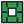 | [Enclosed Court](#enclosed-court) | `ECourt` | component |
|  | [Foyer Halls](#foyer-halls) | `FHalls` | component |
|  | [Gallery Bar](#gallery-bar) | `GBar` | component |
|  | [Linear Plan Generator](#linear-plan-generator) | `Linear` | component |
|  | [Office Plate](#office-plate) | `OPlate` | component |
|  | [Open Court](#open-court) | `OCourt` | component |
|  | [Operating Suite](#operating-suite) | `OSuite` | component |
|  | [Point Plate](#point-plate) | `PPlate` | component |
|  | [Radial Lobes](#radial-lobes) | `RLobes` | component |
|  | [Stair Bay Bar](#stair-bay-bar) | `SBar` | component |
|  | [Stair Pair](#stair-pair) | `SPair` | component |
|  | [Stepped Band](#stepped-band) | `SBand` | component |
|  | [Terrace Row](#terrace-row) | `Terr` | component |
|  | [Transform Plan](#transform-plan) | `TPlan` | component |
|  | [Winged Band](#winged-band) | `WBand` | component |
|  | [DOE Full-Service Restaurant](#doe-full-service-restaurant) | `DoeFSR` | component |
|  | [DOE Hospital](#doe-hospital) | `DoeHosp` | component |
|  | [DOE Large Hotel](#doe-large-hotel) | `DoeLHtl` | component |
|  | [DOE Large Office](#doe-large-office) | `DoeLOff` | component |
|  | [DOE Medium Office](#doe-medium-office) | `DoeMOff` | component |
|  | [DOE Outpatient](#doe-outpatient) | `DoeOutP` | component |
| 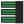 | [DOE Primary School](#doe-primary-school) | `DoePSch` | component |
|  | [DOE Quick-Service Restaurant](#doe-quick-service-restaurant) | `DoeQSR` | component |
|  | [DOE Secondary School](#doe-secondary-school) | `DoeSSch` | component |
| 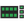 | [DOE Small Hotel](#doe-small-hotel) | `DoeSHot` | component |
|  | [DOE Small Office](#doe-small-office) | `DoeSOff` | component |
|  | [DOE Stand-alone Retail](#doe-stand-alone-retail) | `DoeRet` | component |
|  | [DOE Strip Mall](#doe-strip-mall) | `DoeSMall` | component |
|  | [DOE Supermarket](#doe-supermarket) | `DoeSMkt` | component |
|  | [DOE Warehouse](#doe-warehouse) | `DoeWare` | component |

## Branching Mall

Component · nickname `BMall` · GUID `d886b33f-7b51-41f9-b160-a550e6aadd2b` · exposure primary

Branching public mall between retail wings (SYN-TYP-014): one mall zone through a central court and three or four branches, each with a shop wing on either side of the mall and an anchor store at its end; every shop wing and anchor adjoins the mall. One zone per department. All lengths in metres regardless of model units.

**Inputs**

| Name | Nickname | Type | Access | Optional | Default | Description |
| --- | --- | --- | --- | --- | --- | --- |
| Branch Count | `BC` | Integer | item | no | `3` | Number of branches, east, north, west, then south of the central court; 3 or 4. |
| Branch Length | `BL` | Number | item | no | `40` | Length of the shop wings along each branch, m. |
| Mall Width | `MW` | Number | item | no | `8` | Width of the public mall in each branch, m. |
| Shop Depth | `SD` | Number | item | no | `12` | Depth of the shop wing on each side of the mall, m. |
| Anchor Depth | `AD` | Number | item | no | `30` | Depth of the anchor store at the end of each branch, m. |
| Floor Height | `FH` | Number | item | no | `5` | Floor-to-floor height, m. |
| Orientation | `O` | Number | item | no | `0` | Clockwise rotation of plan north from true north, degrees. |
| Mall | `Ma` | [Program Preset](info.md#program-preset) | item | no | – | Program preset of the public mall; space type Mall. An Any Program Preset is accepted too: its zones keep this space type and take the preset's program, and the plan's provenance records it. |
| Retail | `Re` | [Program Preset](info.md#program-preset) | item | no | – | Program preset of the shop wings and anchors; space type Retail. An Any Program Preset is accepted too: its zones keep this space type and take the preset's program, and the plan's provenance records it. |
| Preview Location | `PL` | Vector | item | yes | `{0,0,0}` | Moves this component's viewport preview by this vector, in model units; the data and all outputs keep their true coordinates. |

**Outputs**

| Name | Nickname | Type | Access | Description |
| --- | --- | --- | --- | --- |
| Plan | `Plan` | [Plan](info.md#plan) | item | The detailed plan. |

**Screenshots** of the example `branching-mall.gh`: the plan preview and the building preview.

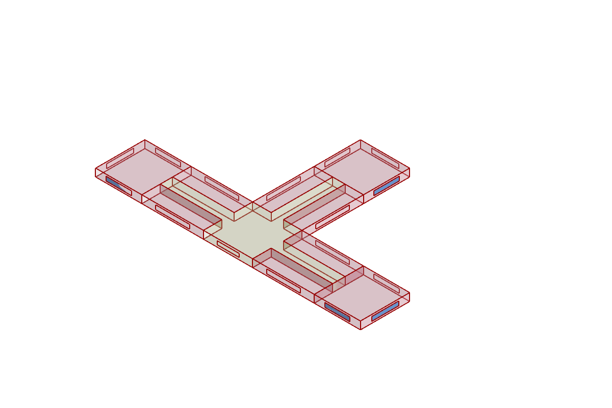

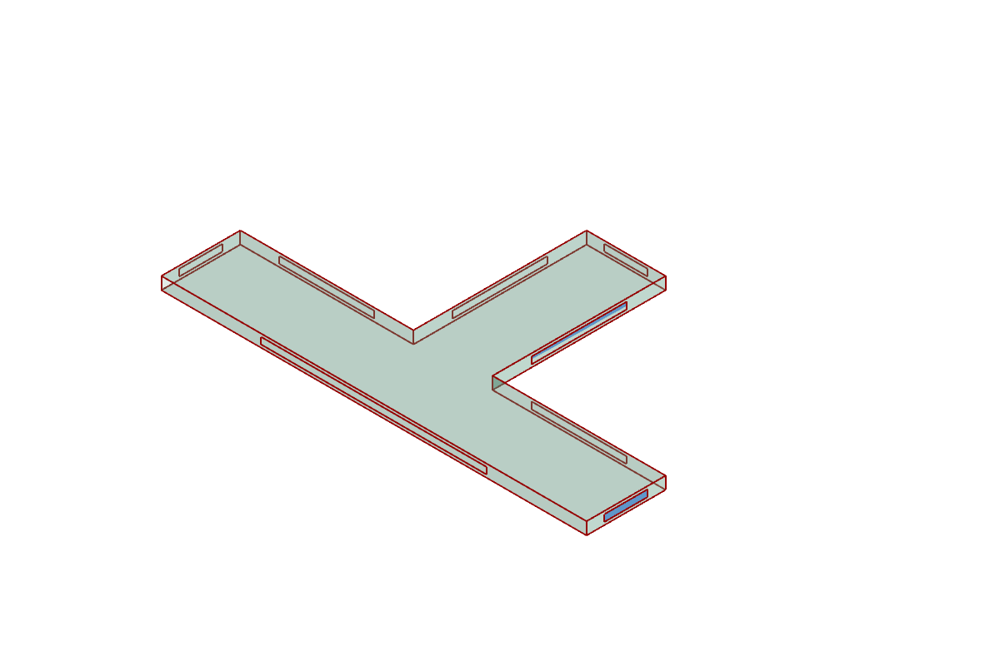

**Example definitions:** `branching-mall.gh` ([canvas](../../assets/screenshots/canvas/branching-mall.png)).

## Cafeteria

Component · nickname `Cafe` · GUID `95956724-ddbc-48ce-9874-0ec6c244c8fe` · exposure primary

Cafeteria service edge beside a dining field (SYN-TYP-016): the kitchen and servery, one zone, along the whole north edge of a larger dining field; the servery counter and the customers' route along it are not zones of their own. One zone per department. All lengths in metres regardless of model units.

**Inputs**

| Name | Nickname | Type | Access | Optional | Default | Description |
| --- | --- | --- | --- | --- | --- | --- |
| Length | `L` | Number | item | no | `30` | Length of the service edge and the dining field along plan x, m. |
| Dining Depth | `DD` | Number | item | no | `15` | Depth of the dining field along plan y, m. |
| Kitchen Depth | `KD` | Number | item | no | `8` | Depth of the kitchen and servery along plan y, m; smaller than Dining Depth. |
| Floor Height | `FH` | Number | item | no | `4` | Floor-to-floor height, m. |
| Orientation | `O` | Number | item | no | `0` | Clockwise rotation of plan north from true north, degrees. |
| Kitchen | `Ki` | [Program Preset](info.md#program-preset) | item | no | – | Program preset of the kitchen and servery; space type Kitchen. An Any Program Preset is accepted too: its zones keep this space type and take the preset's program, and the plan's provenance records it. |
| Dining | `Di` | [Program Preset](info.md#program-preset) | item | no | – | Program preset of the dining field; space type Dining. An Any Program Preset is accepted too: its zones keep this space type and take the preset's program, and the plan's provenance records it. |
| Preview Location | `PL` | Vector | item | yes | `{0,0,0}` | Moves this component's viewport preview by this vector, in model units; the data and all outputs keep their true coordinates. |

**Outputs**

| Name | Nickname | Type | Access | Description |
| --- | --- | --- | --- | --- |
| Plan | `Plan` | [Plan](info.md#plan) | item | The detailed plan. |

**Screenshots** of the example `cafeteria.gh`: the plan preview and the building preview.

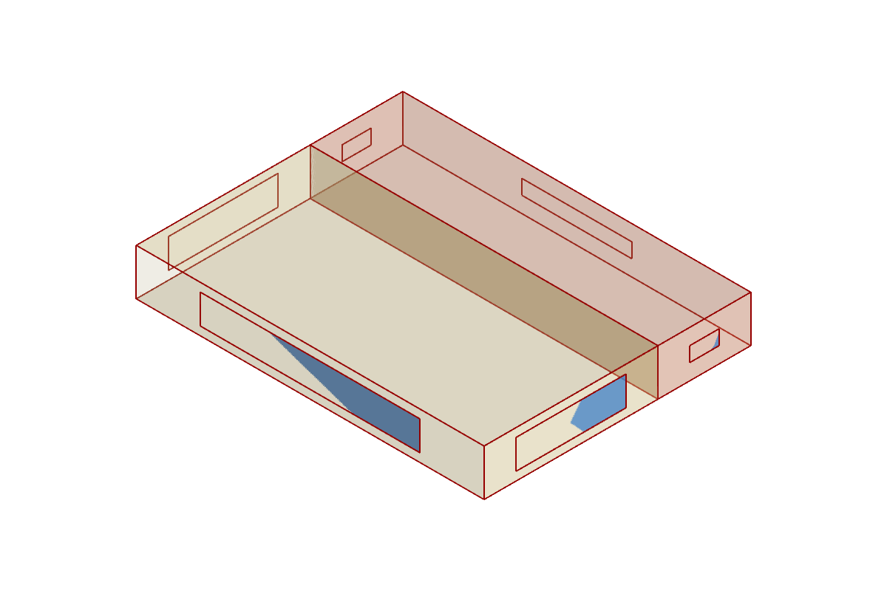

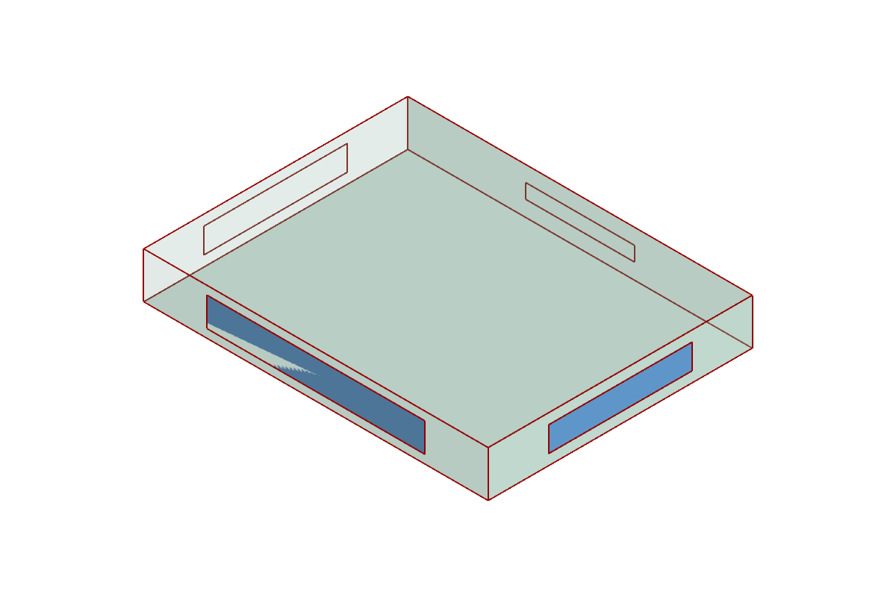

**Example definitions:** `cafeteria.gh` ([canvas](../../assets/screenshots/canvas/cafeteria.png)).

## Care Hub

Component · nickname `CHub` · GUID `7d3d1002-c695-47df-afd9-48f50c5b3e90` · exposure primary

Communal hub serving elder-care bedroom groups (SYN-TYP-018): two to four wings around a communal hub, each a corridor from the hub to the wing's end with a group of bedrooms on each side; every wing corridor adjoins the hub. One zone per department. All lengths in metres regardless of model units.

**Inputs**

| Name | Nickname | Type | Access | Optional | Default | Description |
| --- | --- | --- | --- | --- | --- | --- |
| Wing Count | `WC` | Integer | item | no | `3` | Number of bedroom wings, east, north, west, then south of the hub; 2 to 4. |
| Wing Length | `WL` | Number | item | no | `30` | Length of each wing from the hub to its end, m. |
| Bedroom Depth | `BD` | Number | item | no | `6` | Depth of the bedrooms on each side of a wing corridor, m. |
| Corridor Width | `CoW` | Number | item | no | `2.4` | Width of each wing corridor, m. |
| Hub Width | `HW` | Number | item | no | `16` | Side of the square communal hub, m; at least the wing width, twice Bedroom Depth plus Corridor Width. |
| Floor Height | `FH` | Number | item | no | `3` | Floor-to-floor height, m. |
| Orientation | `O` | Number | item | no | `0` | Clockwise rotation of plan north from true north, degrees. |
| Care Bedroom | `CB` | [Program Preset](info.md#program-preset) | item | no | – | Program preset of the bedroom groups; space type CareBedroom. An Any Program Preset is accepted too: its zones keep this space type and take the preset's program, and the plan's provenance records it. |
| Care Communal | `CC` | [Program Preset](info.md#program-preset) | item | no | – | Program preset of the communal hub; space type CareCommunal. An Any Program Preset is accepted too: its zones keep this space type and take the preset's program, and the plan's provenance records it. |
| Corridor | `Co` | [Program Preset](info.md#program-preset) | item | no | – | Program preset of the wing corridors; space type Corridor. An Any Program Preset is accepted too: its zones keep this space type and take the preset's program, and the plan's provenance records it. |
| Preview Location | `PL` | Vector | item | yes | `{0,0,0}` | Moves this component's viewport preview by this vector, in model units; the data and all outputs keep their true coordinates. |

**Outputs**

| Name | Nickname | Type | Access | Description |
| --- | --- | --- | --- | --- |
| Plan | `Plan` | [Plan](info.md#plan) | item | The detailed plan. |

**Screenshots** of the example `care-hub.gh`: the plan preview and the building preview.

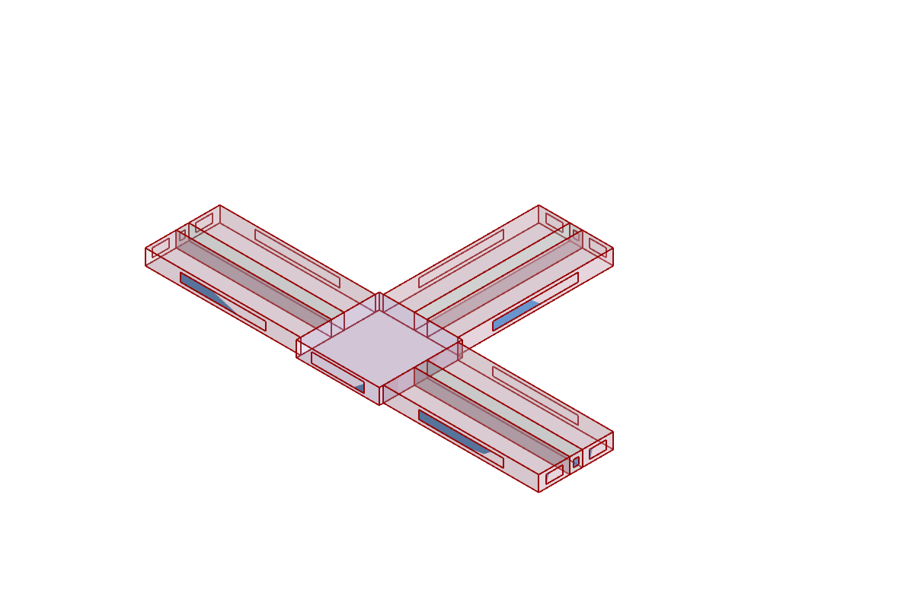

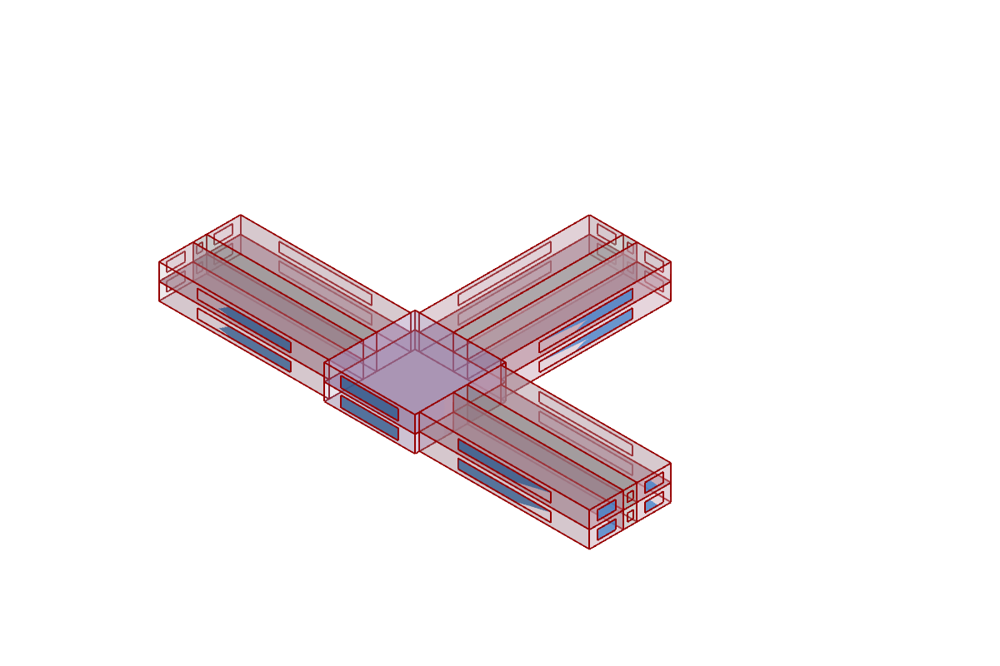

**Example definitions:** `care-hub.gh` ([canvas](../../assets/screenshots/canvas/care-hub.png)).

## Court Cluster

Component · nickname `CCluster` · GUID `01fc2ca9-3ec0-4142-b827-2519a4523d36` · exposure primary

Linked housing clusters around several courts (SYN-TYP-011): a row of courts closed by wings of stair bays, south and north wings across the full width and a west, middle, and east wing between them, each middle wing bordering two courts. The footprint has one hole per court; the court façades are outdoor walls with windows. One zone per dwelling unit. All lengths in metres regardless of model units.

**Inputs**

| Name | Nickname | Type | Access | Optional | Default | Description |
| --- | --- | --- | --- | --- | --- | --- |
| Court Count | `CC` | Integer | item | no | `2` | Number of courts in a row along plan x; at least 2. |
| Court Width | `CW` | Number | item | no | `24` | Width of every court between the wings on its west and east sides, m. |
| Court Depth | `CD` | Number | item | no | `24` | Depth of every court between the south and north wings, which is also the west, middle, and east wings' length, m. |
| Depth | `D` | Number | item | no | `12` | Depth of every wing, which every dwelling and stair spans, m. |
| Unit Width | `UW` | Number | item | no | `7` | Target dwelling width, m; adjusted so the stair bays fill each wing exactly. |
| Stair Width | `SW` | Number | item | no | `3` | Width of each stair along the wings, m. |
| Floor Height | `FH` | Number | item | no | `3` | Floor-to-floor height, m. |
| Orientation | `O` | Number | item | no | `0` | Clockwise rotation of plan north from true north, degrees. |
| Dwelling Unit | `DU` | [Program Preset](info.md#program-preset) | item | no | – | Program preset of the dwellings; space type DwellingUnit. An Any Program Preset is accepted too: its zones keep this space type and take the preset's program, and the plan's provenance records it. |
| Stair | `St` | [Program Preset](info.md#program-preset) | item | no | – | Program preset of the stairs; space type Stair. An Any Program Preset is accepted too: its zones keep this space type and take the preset's program, and the plan's provenance records it. |
| Preview Location | `PL` | Vector | item | yes | `{0,0,0}` | Moves this component's viewport preview by this vector, in model units; the data and all outputs keep their true coordinates. |

**Outputs**

| Name | Nickname | Type | Access | Description |
| --- | --- | --- | --- | --- |
| Plan | `Plan` | [Plan](info.md#plan) | item | The detailed plan. |

**Screenshots** of the example `court-cluster.gh`: the plan preview and the building preview.

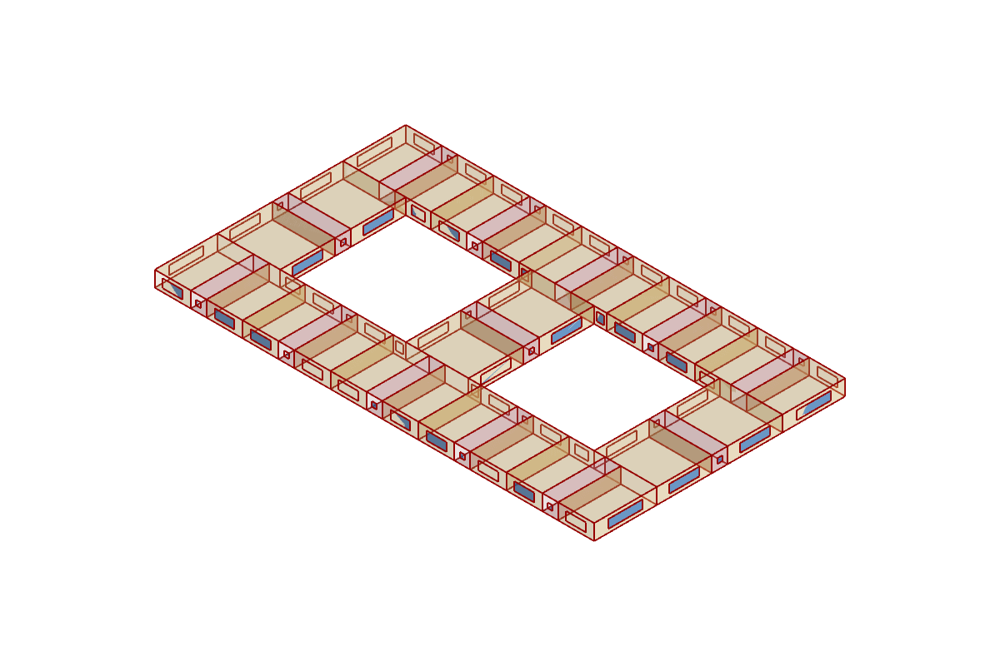

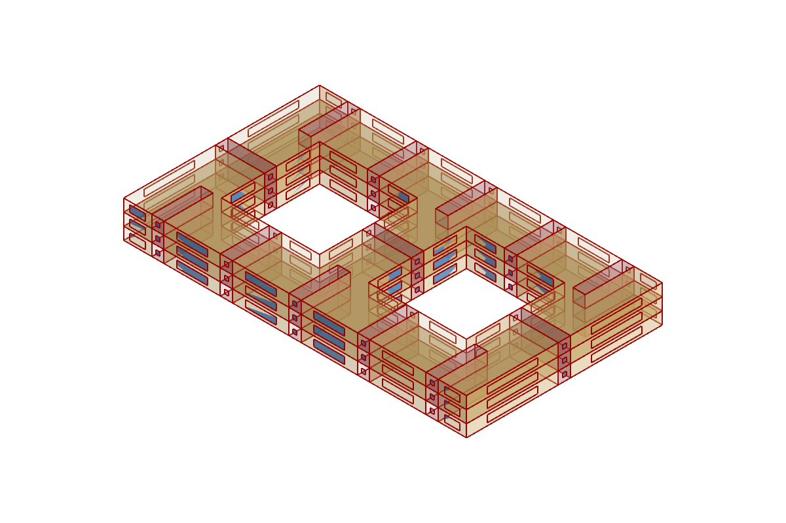

**Example definitions:** `court-cluster.gh` ([canvas](../../assets/screenshots/canvas/court-cluster.png)).

## Enclosed Court

Component · nickname `ECourt` · GUID `b9765cd0-a62b-483d-9470-86d5fda287e8` · exposure primary

Enclosed courtyard residential block (HDHM-TYP-005): south, north, west, and east wings of stair bays around one court closed on all four sides. The footprint has the court as a hole; the court façades are outdoor walls with windows. One zone per dwelling unit. All lengths in metres regardless of model units.

**Inputs**

| Name | Nickname | Type | Access | Optional | Default | Description |
| --- | --- | --- | --- | --- | --- | --- |
| Court Width | `CW` | Number | item | no | `24` | Width of the court between the west and east wings, m. |
| Court Depth | `CD` | Number | item | no | `24` | Depth of the court between the south and north wings, which is also the west and east wings' length, m. |
| Depth | `D` | Number | item | no | `12` | Depth of every wing, which every dwelling and stair spans, m. |
| Unit Width | `UW` | Number | item | no | `7` | Target dwelling width, m; adjusted so the stair bays fill each wing exactly. |
| Stair Width | `SW` | Number | item | no | `3` | Width of each stair along the wings, m. |
| Floor Height | `FH` | Number | item | no | `3` | Floor-to-floor height, m. |
| Orientation | `O` | Number | item | no | `0` | Clockwise rotation of plan north from true north, degrees. |
| Dwelling Unit | `DU` | [Program Preset](info.md#program-preset) | item | no | – | Program preset of the dwellings; space type DwellingUnit. An Any Program Preset is accepted too: its zones keep this space type and take the preset's program, and the plan's provenance records it. |
| Stair | `St` | [Program Preset](info.md#program-preset) | item | no | – | Program preset of the stairs; space type Stair. An Any Program Preset is accepted too: its zones keep this space type and take the preset's program, and the plan's provenance records it. |
| Preview Location | `PL` | Vector | item | yes | `{0,0,0}` | Moves this component's viewport preview by this vector, in model units; the data and all outputs keep their true coordinates. |

**Outputs**

| Name | Nickname | Type | Access | Description |
| --- | --- | --- | --- | --- |
| Plan | `Plan` | [Plan](info.md#plan) | item | The detailed plan. |

**Screenshots** of the example `enclosed-court.gh`: the plan preview and the building preview.

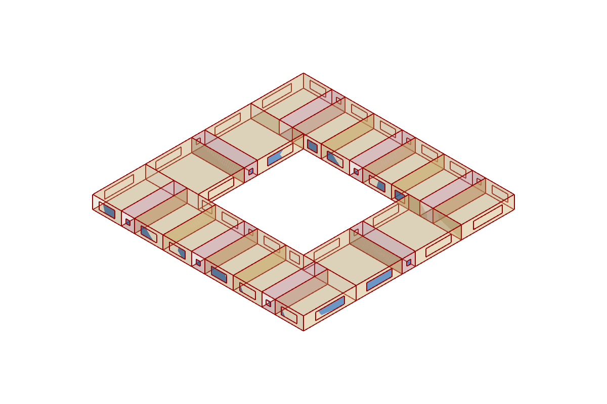

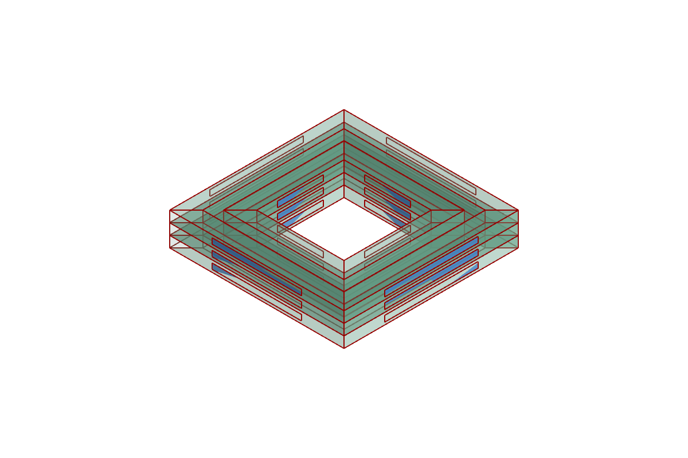

**Example definitions:** `enclosed-court.gh` ([canvas](../../assets/screenshots/canvas/enclosed-court.png)).

## Foyer Halls

Component · nickname `FHalls` · GUID `6638efe7-c0e8-45b6-89b1-1e9e3f725c15` · exposure primary

Public foyer branching to distinct activity spaces (SYN-TYP-019): two or three activity halls and a support wing around a common foyer (hall 1 east, support north, hall 2 west, hall 3 south); every hall and the support wing adjoins the foyer. One zone per department. All lengths in metres regardless of model units.

**Inputs**

| Name | Nickname | Type | Access | Optional | Default | Description |
| --- | --- | --- | --- | --- | --- | --- |
| Hall Count | `HC` | Integer | item | no | `2` | Number of activity halls; 2 or 3 (the support wing takes the foyer's north side). |
| Hall Length | `HL` | Number | item | no | `30` | Length of each hall from the foyer to its end, m. |
| Hall Width | `HW` | Number | item | no | `20` | Width of each hall and of the support wing along the foyer's side, m; at most Foyer Width. |
| Support Length | `SL` | Number | item | no | `10` | Length of the support wing from the foyer to its end, m. |
| Foyer Width | `FW` | Number | item | no | `20` | Side of the square foyer, m. |
| Floor Height | `FH` | Number | item | no | `6` | Floor-to-floor height, m. |
| Orientation | `O` | Number | item | no | `0` | Clockwise rotation of plan north from true north, degrees. |
| Lobby | `Lo` | [Program Preset](info.md#program-preset) | item | no | – | Program preset of the foyer; space type Lobby. An Any Program Preset is accepted too: its zones keep this space type and take the preset's program, and the plan's provenance records it. |
| Activity Hall | `AH` | [Program Preset](info.md#program-preset) | item | no | – | Program preset of the activity halls; space type ActivityHall. An Any Program Preset is accepted too: its zones keep this space type and take the preset's program, and the plan's provenance records it. |
| Service | `Sv` | [Program Preset](info.md#program-preset) | item | no | – | Program preset of the support wing; space type Service. An Any Program Preset is accepted too: its zones keep this space type and take the preset's program, and the plan's provenance records it. |
| Preview Location | `PL` | Vector | item | yes | `{0,0,0}` | Moves this component's viewport preview by this vector, in model units; the data and all outputs keep their true coordinates. |

**Outputs**

| Name | Nickname | Type | Access | Description |
| --- | --- | --- | --- | --- |
| Plan | `Plan` | [Plan](info.md#plan) | item | The detailed plan. |

**Screenshots** of the example `foyer-halls.gh`: the plan preview and the building preview.

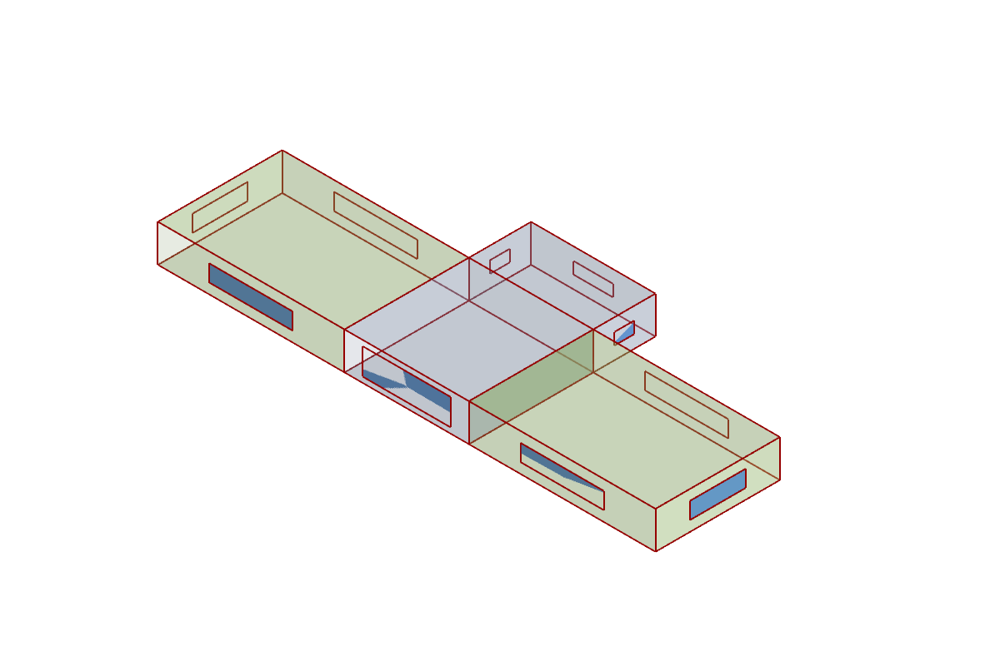

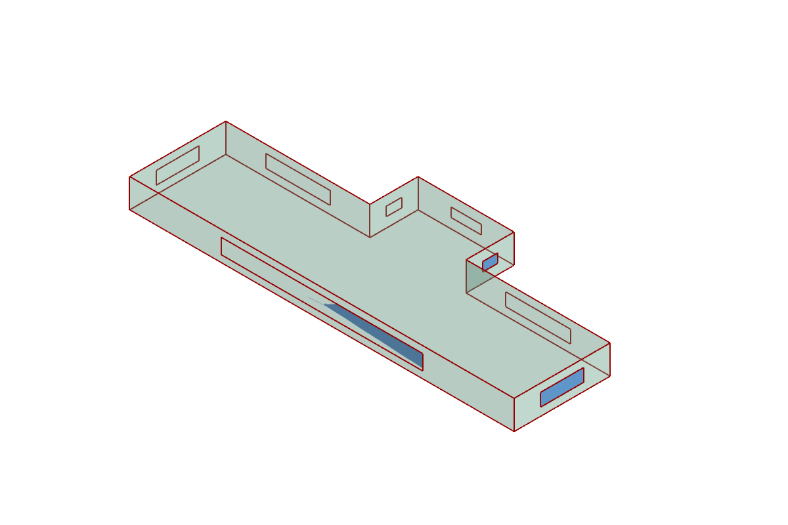

**Example definitions:** `foyer-halls.gh` ([canvas](../../assets/screenshots/canvas/foyer-halls.png)).

## Gallery Bar

Component · nickname `GBar` · GUID `a58df462-b3c2-46b7-be3d-7ea9f4629280` · exposure primary

Continuous external gallery beside a linear bar (HDHM-TYP-002): a row of dwellings through the bar depth with a stair at each end. The gallery is not modelled: no gallery zone or geometry; its façade is an ordinary outdoor façade. One zone per dwelling unit. All lengths in metres regardless of model units.

**Inputs**

| Name | Nickname | Type | Access | Optional | Default | Description |
| --- | --- | --- | --- | --- | --- | --- |
| Unit Count | `UC` | Integer | item | no | `6` | Number of dwellings along the bar; at least 2. |
| Unit Width | `UW` | Number | item | no | `6` | Width of each dwelling along the bar, m. |
| Depth | `D` | Number | item | no | `10` | Bar depth, which every dwelling and both stairs span, m. |
| Stair Width | `SW` | Number | item | no | `4` | Width of each end stair along the bar, m. |
| Floor Height | `FH` | Number | item | no | `3` | Floor-to-floor height, m. |
| Orientation | `O` | Number | item | no | `0` | Clockwise rotation of plan north from true north, degrees. |
| Dwelling Unit | `DU` | [Program Preset](info.md#program-preset) | item | no | – | Program preset of the dwellings; space type DwellingUnit. An Any Program Preset is accepted too: its zones keep this space type and take the preset's program, and the plan's provenance records it. |
| Stair | `St` | [Program Preset](info.md#program-preset) | item | no | – | Program preset of the two end stairs; space type Stair. An Any Program Preset is accepted too: its zones keep this space type and take the preset's program, and the plan's provenance records it. |
| Preview Location | `PL` | Vector | item | yes | `{0,0,0}` | Moves this component's viewport preview by this vector, in model units; the data and all outputs keep their true coordinates. |

**Outputs**

| Name | Nickname | Type | Access | Description |
| --- | --- | --- | --- | --- |
| Plan | `Plan` | [Plan](info.md#plan) | item | The detailed plan. |

**Screenshots** of the example `gallery-bar.gh`: the plan preview and the building preview.

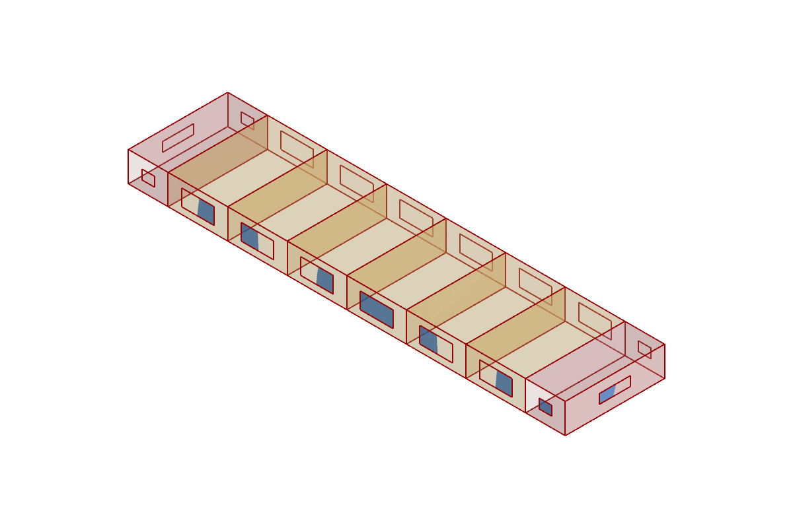

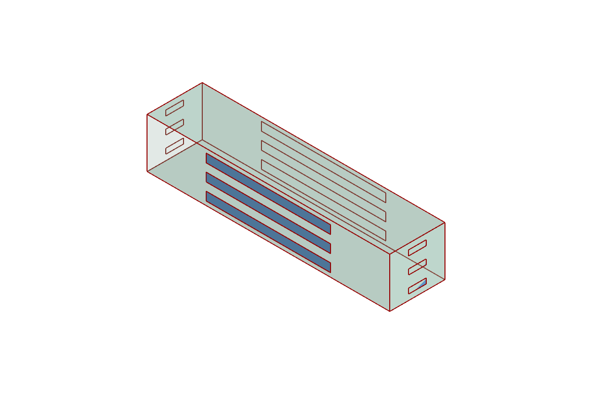

**Example definitions:** `gallery-bar.gh` ([canvas](../../assets/screenshots/canvas/gallery-bar.png)).

## Linear Plan Generator

Component · nickname `Linear` · GUID `a4a9131e-0a0f-49e0-99a4-f26760f6810f` · exposure primary

Detailed linear block plan, the double-sided internal corridor bar (HDHM-TYP-009): west stair, double-loaded corridor, one zone per dwelling unit. All lengths in metres regardless of model units.

**Inputs**

| Name | Nickname | Type | Access | Optional | Default | Description |
| --- | --- | --- | --- | --- | --- | --- |
| Length | `L` | Number | item | no | `24` | Plan length along X, m. |
| Unit Depth | `UD` | Number | item | no | `8` | Depth of each unit row, m. |
| Corridor Width | `CW` | Number | item | no | `2` | Corridor width, m. |
| Unit Width | `UW` | Number | item | no | `10` | Target unit width, m; the row is divided evenly. |
| Stair Length | `SL` | Number | item | no | `4` | Length of the west stair, m. |
| Floor Height | `FH` | Number | item | no | `3` | Floor-to-floor height, m. |
| Orientation | `O` | Number | item | no | `0` | Clockwise rotation of plan north from true north, degrees. |
| Dwelling Unit | `DU` | [Program Preset](info.md#program-preset) | item | no | – | Program preset of the dwelling units; space type DwellingUnit. An Any Program Preset is accepted too: its zones keep this space type and take the preset's program, and the plan's provenance records it. |
| Corridor | `Co` | [Program Preset](info.md#program-preset) | item | no | – | Program preset of the corridor; space type Corridor. An Any Program Preset is accepted too: its zones keep this space type and take the preset's program, and the plan's provenance records it. |
| Stair | `St` | [Program Preset](info.md#program-preset) | item | no | – | Program preset of the stair; space type Stair. An Any Program Preset is accepted too: its zones keep this space type and take the preset's program, and the plan's provenance records it. |
| Preview Location | `PL` | Vector | item | yes | `{0,0,0}` | Moves this component's viewport preview by this vector, in model units; the data and all outputs keep their true coordinates. |

**Outputs**

| Name | Nickname | Type | Access | Description |
| --- | --- | --- | --- | --- |
| Plan | `Plan` | [Plan](info.md#plan) | item | The detailed plan. |

**Screenshots** of the example `linear-plan.gh`: the plan preview and the building preview.

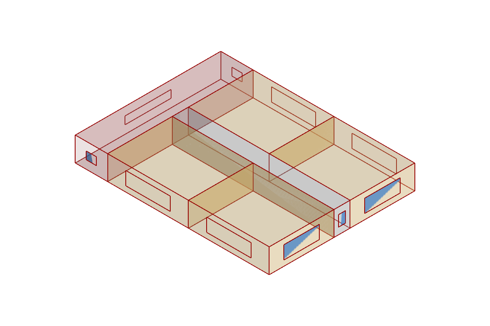

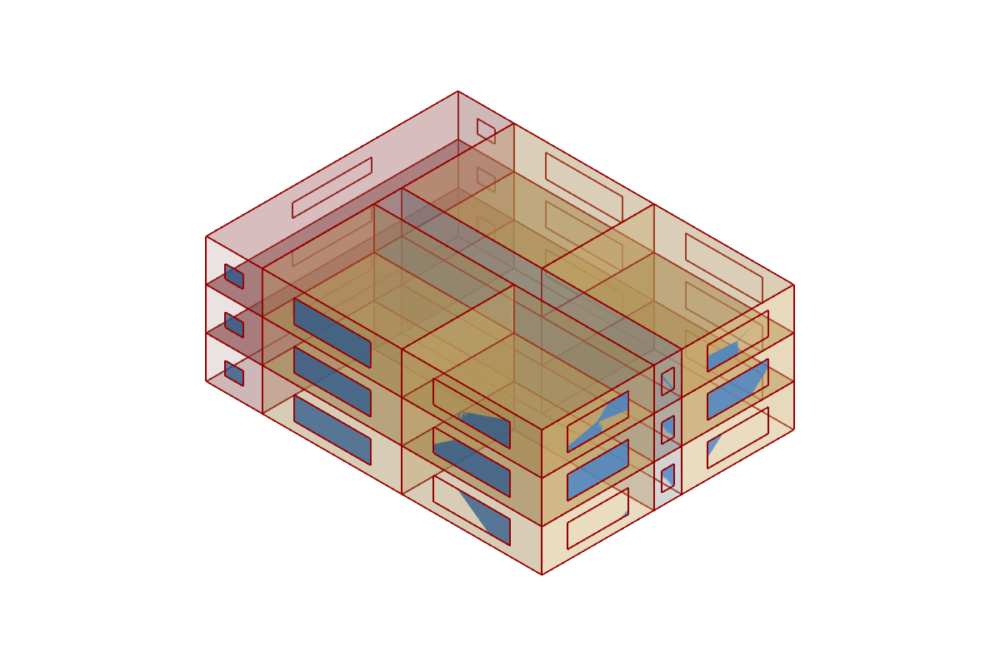

**Example definitions:** `end-to-end.gh` ([canvas](../../assets/screenshots/canvas/end-to-end.png)), `linear-plan.gh` ([canvas](../../assets/screenshots/canvas/linear-plan.png)).

## Office Plate

Component · nickname `OPlate` · GUID `783cefaa-b836-4dbc-b16d-8e74820ed361` · exposure primary

Central service core within an office plate (SYN-TYP-017): a rectangular plate whose office work area is one zone, a ring around a central Core zone without outdoor walls; the core leaves at least 3 m of work area on every side. One zone per department. All lengths in metres regardless of model units.

**Inputs**

| Name | Nickname | Type | Access | Optional | Default | Description |
| --- | --- | --- | --- | --- | --- | --- |
| Plate Length | `L` | Number | item | no | `42` | Plate length along plan x, m. |
| Plate Depth | `D` | Number | item | no | `30` | Plate depth along plan y, m. |
| Core Length | `CL` | Number | item | no | `18` | Length of the central core along plan x, m. |
| Core Depth | `CD` | Number | item | no | `6` | Depth of the central core along plan y, m. |
| Floor Height | `FH` | Number | item | no | `3.8` | Floor-to-floor height, m. |
| Orientation | `O` | Number | item | no | `0` | Clockwise rotation of plan north from true north, degrees. |
| Office | `Of` | [Program Preset](info.md#program-preset) | item | no | – | Program preset of the office work area; space type Office. An Any Program Preset is accepted too: its zones keep this space type and take the preset's program, and the plan's provenance records it. |
| Core | `Co` | [Program Preset](info.md#program-preset) | item | no | – | Program preset of the service core; space type Core. An Any Program Preset is accepted too: its zones keep this space type and take the preset's program, and the plan's provenance records it. |
| Preview Location | `PL` | Vector | item | yes | `{0,0,0}` | Moves this component's viewport preview by this vector, in model units; the data and all outputs keep their true coordinates. |

**Outputs**

| Name | Nickname | Type | Access | Description |
| --- | --- | --- | --- | --- |
| Plan | `Plan` | [Plan](info.md#plan) | item | The detailed plan. |

**Screenshots** of the example `office-plate.gh`: the plan preview and the building preview.

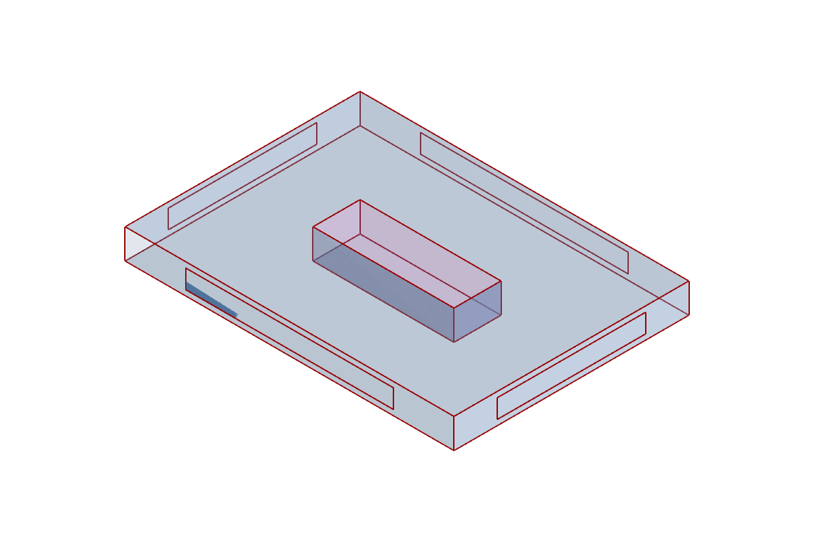

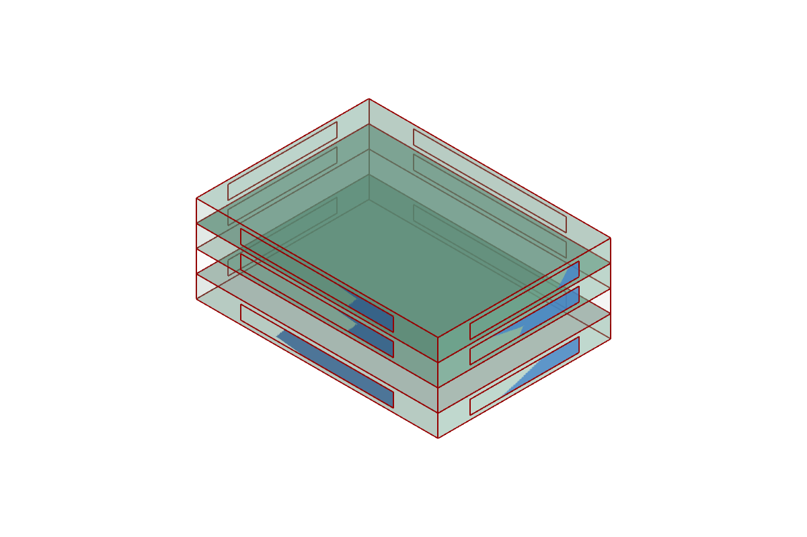

**Example definitions:** `office-plate.gh` ([canvas](../../assets/screenshots/canvas/office-plate.png)), `program-json-office.gh` ([canvas](../../assets/screenshots/canvas/program-json-office.png)), `schedule-draw.gh` ([canvas](../../assets/screenshots/canvas/schedule-draw.png)).

## Open Court

Component · nickname `OCourt` · GUID `223014ea-3c01-4d2b-b8ba-92ebdc4a7327` · exposure primary

Open U-shaped court with stair-served wings (HDHM-TYP-004): west, east, and north wings of stair bays around a court open to plan south, every dwelling adjoining a stair. One zone per dwelling unit. All lengths in metres regardless of model units.

**Inputs**

| Name | Nickname | Type | Access | Optional | Default | Description |
| --- | --- | --- | --- | --- | --- | --- |
| Court Width | `CW` | Number | item | no | `24` | Width of the court between the side wings, m. |
| Court Depth | `CD` | Number | item | no | `17` | Depth of the court from its open side to the north wing, which is also the side wings' length, m. |
| Depth | `D` | Number | item | no | `12` | Depth of every wing, which every dwelling and stair spans, m. |
| Unit Width | `UW` | Number | item | no | `7` | Target dwelling width, m; adjusted so the stair bays fill each wing exactly. |
| Stair Width | `SW` | Number | item | no | `3` | Width of each stair along the wings, m. |
| Floor Height | `FH` | Number | item | no | `3` | Floor-to-floor height, m. |
| Orientation | `O` | Number | item | no | `0` | Clockwise rotation of plan north from true north, degrees. |
| Dwelling Unit | `DU` | [Program Preset](info.md#program-preset) | item | no | – | Program preset of the dwellings; space type DwellingUnit. An Any Program Preset is accepted too: its zones keep this space type and take the preset's program, and the plan's provenance records it. |
| Stair | `St` | [Program Preset](info.md#program-preset) | item | no | – | Program preset of the stairs; space type Stair. An Any Program Preset is accepted too: its zones keep this space type and take the preset's program, and the plan's provenance records it. |
| Preview Location | `PL` | Vector | item | yes | `{0,0,0}` | Moves this component's viewport preview by this vector, in model units; the data and all outputs keep their true coordinates. |

**Outputs**

| Name | Nickname | Type | Access | Description |
| --- | --- | --- | --- | --- |
| Plan | `Plan` | [Plan](info.md#plan) | item | The detailed plan. |

**Screenshots** of the example `open-court.gh`: the plan preview and the building preview.

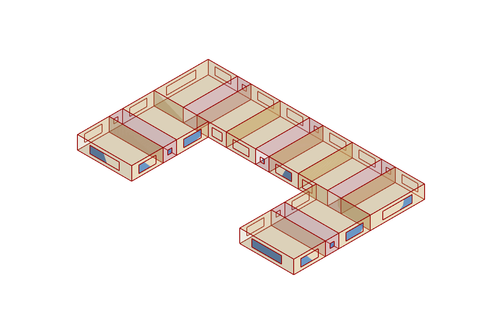

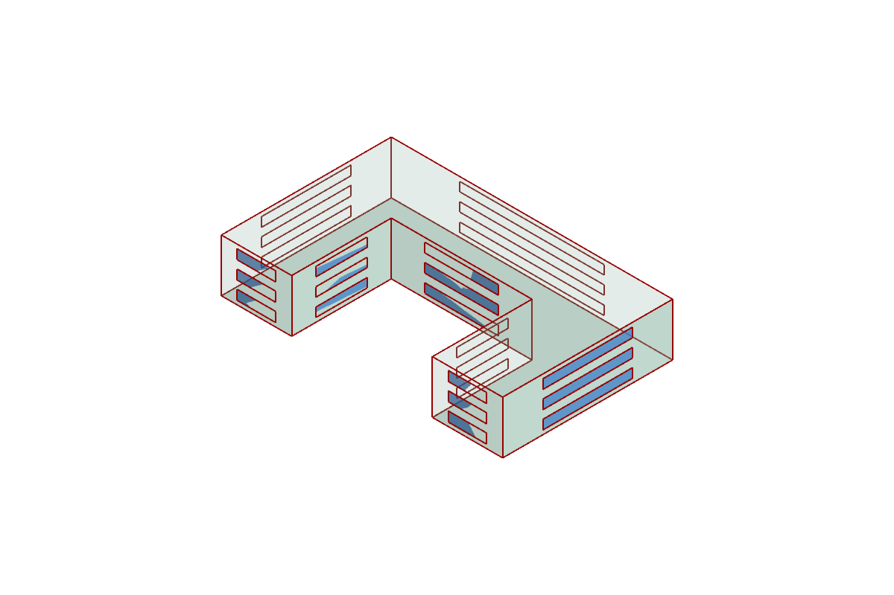

**Example definitions:** `open-court.gh` ([canvas](../../assets/screenshots/canvas/open-court.png)).

## Operating Suite

Component · nickname `OSuite` · GUID `33323afd-abf1-4ecc-bf54-5d67c411c962` · exposure primary

Operating suite with separated clean and dirty routes (SYN-TYP-015): support rooms across the west end, then bands from south to north of a dirty corridor and theatre banks, each followed by a corridor, alternating clean and dirty; every bank lies between one clean and one dirty corridor, and every bank and corridor adjoins the support rooms. One zone per department. All lengths in metres regardless of model units.

**Inputs**

| Name | Nickname | Type | Access | Optional | Default | Description |
| --- | --- | --- | --- | --- | --- | --- |
| Bank Count | `BC` | Integer | item | no | `2` | Number of theatre banks; at least 2. |
| Bank Length | `BL` | Number | item | no | `36` | Length of every bank and corridor from the support rooms to the east façade, m. |
| Theatre Depth | `TD` | Number | item | no | `7` | Depth of every theatre bank across the bands, m. |
| Clean Corridor Width | `CW` | Number | item | no | `3` | Width of every clean corridor, m. |
| Dirty Corridor Width | `DW` | Number | item | no | `2.4` | Width of every dirty corridor, m. |
| Support Length | `SL` | Number | item | no | `12` | Length of the support rooms across the suite's west end, m. |
| Floor Height | `FH` | Number | item | no | `4.2` | Floor-to-floor height, m. |
| Orientation | `O` | Number | item | no | `0` | Clockwise rotation of plan north from true north, degrees. |
| Operating Theatre | `OT` | [Program Preset](info.md#program-preset) | item | no | – | Program preset of the theatre banks; space type OperatingTheatre. An Any Program Preset is accepted too: its zones keep this space type and take the preset's program, and the plan's provenance records it. |
| Clean Corridor | `Clean` | [Program Preset](info.md#program-preset) | item | no | – | Program preset of the clean corridors; space type CleanCorridor. An Any Program Preset is accepted too: its zones keep this space type and take the preset's program, and the plan's provenance records it. |
| Dirty Corridor | `Dirty` | [Program Preset](info.md#program-preset) | item | no | – | Program preset of the dirty corridors; space type DirtyCorridor. An Any Program Preset is accepted too: its zones keep this space type and take the preset's program, and the plan's provenance records it. |
| Clinical Support | `CS` | [Program Preset](info.md#program-preset) | item | no | – | Program preset of the support rooms; space type ClinicalSupport. An Any Program Preset is accepted too: its zones keep this space type and take the preset's program, and the plan's provenance records it. |
| Preview Location | `PL` | Vector | item | yes | `{0,0,0}` | Moves this component's viewport preview by this vector, in model units; the data and all outputs keep their true coordinates. |

**Outputs**

| Name | Nickname | Type | Access | Description |
| --- | --- | --- | --- | --- |
| Plan | `Plan` | [Plan](info.md#plan) | item | The detailed plan. |

**Screenshots** of the example `operating-suite.gh`: the plan preview and the building preview.

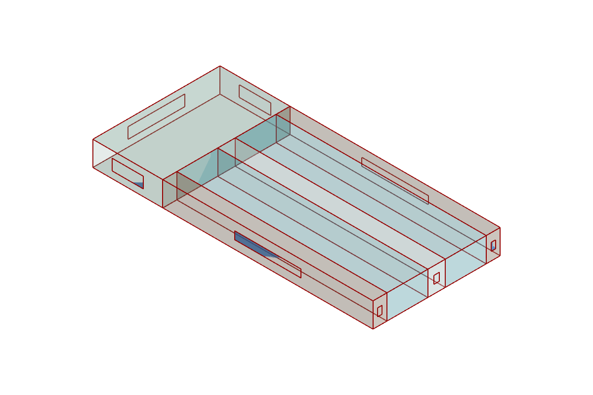

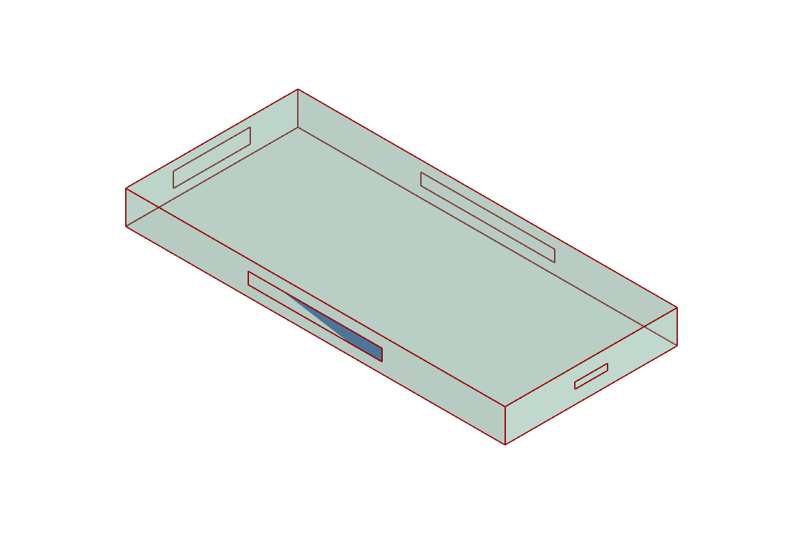

**Example definitions:** `operating-suite.gh` ([canvas](../../assets/screenshots/canvas/operating-suite.png)).

## Point Plate

Component · nickname `PPlate` · GUID `8ac9044a-8fbe-4964-a9de-2ef8be35094a` · exposure primary

Compact point-access tower plate (HDHM-TYP-007): a square plate with one central core, a Stair zone without outdoor walls, and four dwellings in a pinwheel around it, each adjoining the core and with two façades. One zone per dwelling unit. All lengths in metres regardless of model units.

**Inputs**

| Name | Nickname | Type | Access | Optional | Default | Description |
| --- | --- | --- | --- | --- | --- | --- |
| Dwelling Depth | `DD` | Number | item | no | `8` | Depth of each dwelling from its façade to the core, m; the plate side is Core Width + 2 × Dwelling Depth. |
| Core Width | `CW` | Number | item | no | `6` | Side of the square core, m. |
| Floor Height | `FH` | Number | item | no | `3` | Floor-to-floor height, m. |
| Orientation | `O` | Number | item | no | `0` | Clockwise rotation of plan north from true north, degrees. |
| Dwelling Unit | `DU` | [Program Preset](info.md#program-preset) | item | no | – | Program preset of the four dwellings; space type DwellingUnit. An Any Program Preset is accepted too: its zones keep this space type and take the preset's program, and the plan's provenance records it. |
| Stair | `St` | [Program Preset](info.md#program-preset) | item | no | – | Program preset of the core; space type Stair. An Any Program Preset is accepted too: its zones keep this space type and take the preset's program, and the plan's provenance records it. |
| Preview Location | `PL` | Vector | item | yes | `{0,0,0}` | Moves this component's viewport preview by this vector, in model units; the data and all outputs keep their true coordinates. |

**Outputs**

| Name | Nickname | Type | Access | Description |
| --- | --- | --- | --- | --- |
| Plan | `Plan` | [Plan](info.md#plan) | item | The detailed plan. |

**Screenshots** of the example `point-plate.gh`: the plan preview and the building preview.

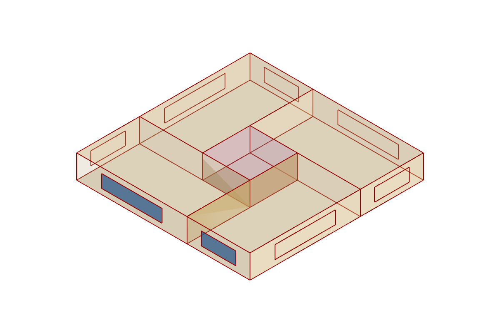

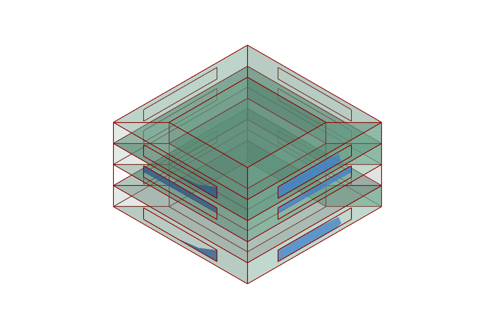

**Example definitions:** `point-plate.gh` ([canvas](../../assets/screenshots/canvas/point-plate.png)).

## Radial Lobes

Component · nickname `RLobes` · GUID `a9f132c2-40c3-40b9-ba6a-3f3e1f2ced80` · exposure primary

Radial lobes around a point tower core (SYN-TYP-010): three or four lobes on the sides of a square core, each holding two dwellings side by side that both adjoin the core; no other circulation. With three lobes the core's south side is a façade. One zone per dwelling unit. All lengths in metres regardless of model units.

**Inputs**

| Name | Nickname | Type | Access | Optional | Default | Description |
| --- | --- | --- | --- | --- | --- | --- |
| Lobe Count | `LC` | Integer | item | no | `4` | Number of lobes, east, north, west, then south of the core; 3 or 4. |
| Lobe Length | `LL` | Number | item | no | `10` | Length of each lobe from the core to its end, which every dwelling spans, m. |
| Lobe Width | `LW` | Number | item | no | `12` | Width of each lobe along the core's side, two dwellings side by side, m; at most Core Width. |
| Core Width | `CW` | Number | item | no | `12` | Side of the square core, m. |
| Floor Height | `FH` | Number | item | no | `3` | Floor-to-floor height, m. |
| Orientation | `O` | Number | item | no | `0` | Clockwise rotation of plan north from true north, degrees. |
| Dwelling Unit | `DU` | [Program Preset](info.md#program-preset) | item | no | – | Program preset of the dwellings; space type DwellingUnit. An Any Program Preset is accepted too: its zones keep this space type and take the preset's program, and the plan's provenance records it. |
| Stair | `St` | [Program Preset](info.md#program-preset) | item | no | – | Program preset of the core; space type Stair. An Any Program Preset is accepted too: its zones keep this space type and take the preset's program, and the plan's provenance records it. |
| Preview Location | `PL` | Vector | item | yes | `{0,0,0}` | Moves this component's viewport preview by this vector, in model units; the data and all outputs keep their true coordinates. |

**Outputs**

| Name | Nickname | Type | Access | Description |
| --- | --- | --- | --- | --- |
| Plan | `Plan` | [Plan](info.md#plan) | item | The detailed plan. |

**Screenshots** of the example `radial-lobes.gh`: the plan preview and the building preview.

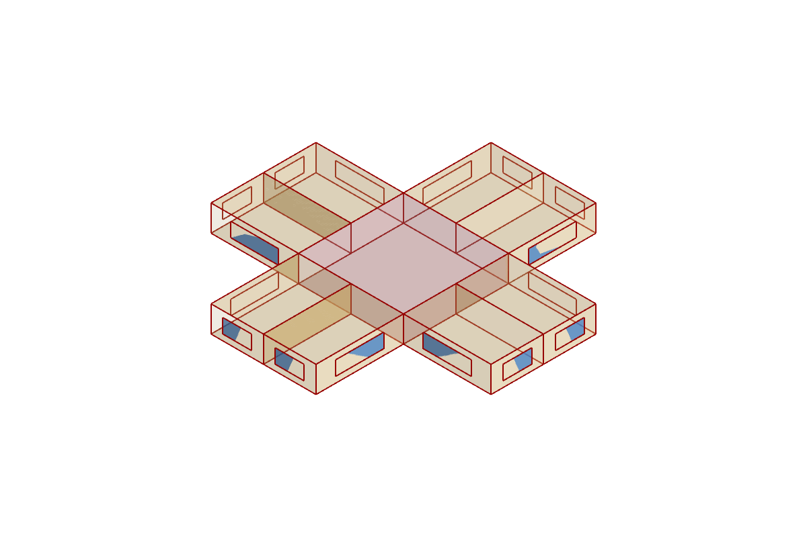

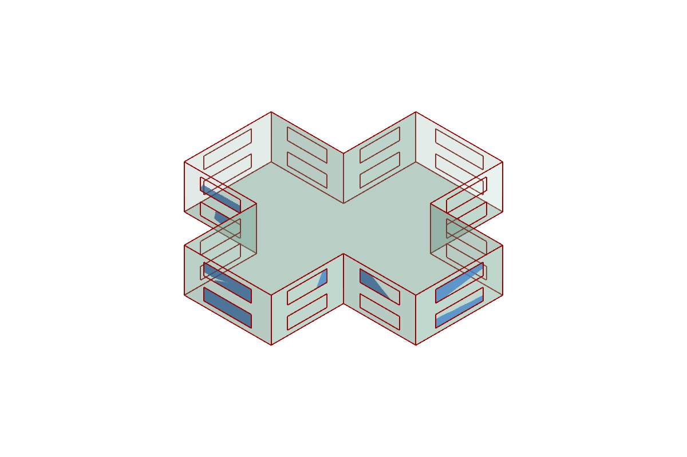

**Example definitions:** `radial-lobes.gh` ([canvas](../../assets/screenshots/canvas/radial-lobes.png)).

## Stair Bay Bar

Component · nickname `SBar` · GUID `911c3204-42bb-4023-bdb7-2931ea1caad3` · exposure primary

Repeated stair bays in a linear bar (HDHM-TYP-001): bays of dwelling | stair | dwelling through the full depth, each stair serving the two dwellings beside it; no corridor. One zone per dwelling unit. All lengths in metres regardless of model units.

**Inputs**

| Name | Nickname | Type | Access | Optional | Default | Description |
| --- | --- | --- | --- | --- | --- | --- |
| Bay Count | `BC` | Integer | item | no | `3` | Number of stair bays along the bar; at least 2. |
| Unit Width | `UW` | Number | item | no | `7` | Width of each dwelling along the bar, m. |
| Depth | `D` | Number | item | no | `12` | Bar depth, which every dwelling and stair spans, m. |
| Stair Width | `SW` | Number | item | no | `3` | Width of each stair along the bar, m. |
| Floor Height | `FH` | Number | item | no | `3` | Floor-to-floor height, m. |
| Orientation | `O` | Number | item | no | `0` | Clockwise rotation of plan north from true north, degrees. |
| Dwelling Unit | `DU` | [Program Preset](info.md#program-preset) | item | no | – | Program preset of the dwellings; space type DwellingUnit. An Any Program Preset is accepted too: its zones keep this space type and take the preset's program, and the plan's provenance records it. |
| Stair | `St` | [Program Preset](info.md#program-preset) | item | no | – | Program preset of the stairs; space type Stair. An Any Program Preset is accepted too: its zones keep this space type and take the preset's program, and the plan's provenance records it. |
| Preview Location | `PL` | Vector | item | yes | `{0,0,0}` | Moves this component's viewport preview by this vector, in model units; the data and all outputs keep their true coordinates. |

**Outputs**

| Name | Nickname | Type | Access | Description |
| --- | --- | --- | --- | --- |
| Plan | `Plan` | [Plan](info.md#plan) | item | The detailed plan. |

**Screenshots** of the example `stair-bay-bar.gh`: the plan preview and the building preview.

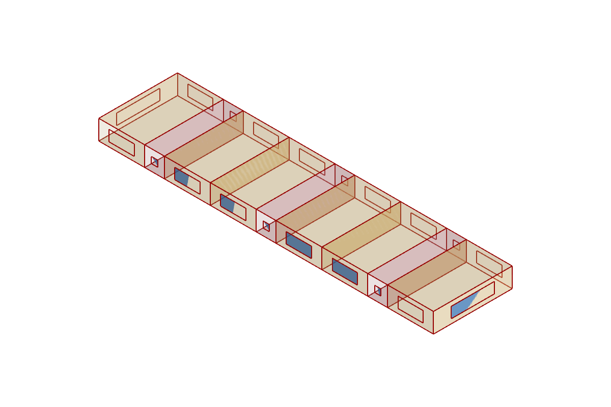

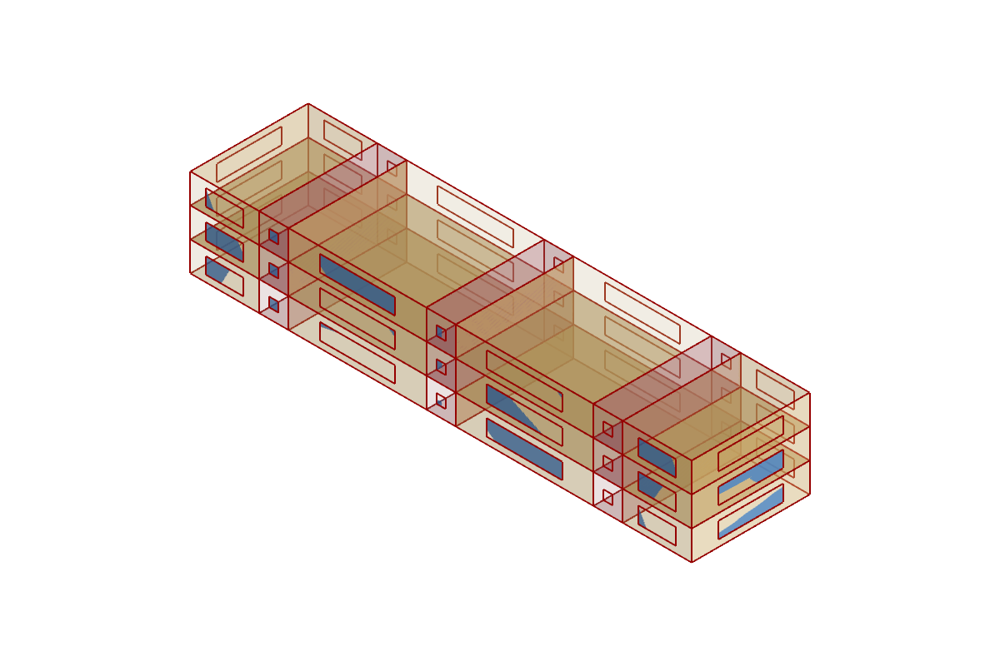

**Example definitions:** `stair-bay-bar.gh` ([canvas](../../assets/screenshots/canvas/stair-bay-bar.png)).

## Stair Pair

Component · nickname `SPair` · GUID `5669d39b-45e6-47ea-9250-f2304d005335` · exposure primary

One stair between a dwelling pair (HDHM-TYP-008): one stair bay of the Stair Bay Bar as its own building, the stair serving both dwellings. One zone per dwelling unit. All lengths in metres regardless of model units.

**Inputs**

| Name | Nickname | Type | Access | Optional | Default | Description |
| --- | --- | --- | --- | --- | --- | --- |
| Unit Width | `UW` | Number | item | no | `7` | Width of each dwelling, m. |
| Depth | `D` | Number | item | no | `12` | Plate depth, which both dwellings and the stair span, m. |
| Stair Width | `SW` | Number | item | no | `3` | Width of the stair between the dwellings, m. |
| Floor Height | `FH` | Number | item | no | `3` | Floor-to-floor height, m. |
| Orientation | `O` | Number | item | no | `0` | Clockwise rotation of plan north from true north, degrees. |
| Dwelling Unit | `DU` | [Program Preset](info.md#program-preset) | item | no | – | Program preset of the two dwellings; space type DwellingUnit. An Any Program Preset is accepted too: its zones keep this space type and take the preset's program, and the plan's provenance records it. |
| Stair | `St` | [Program Preset](info.md#program-preset) | item | no | – | Program preset of the stair; space type Stair. An Any Program Preset is accepted too: its zones keep this space type and take the preset's program, and the plan's provenance records it. |
| Preview Location | `PL` | Vector | item | yes | `{0,0,0}` | Moves this component's viewport preview by this vector, in model units; the data and all outputs keep their true coordinates. |

**Outputs**

| Name | Nickname | Type | Access | Description |
| --- | --- | --- | --- | --- |
| Plan | `Plan` | [Plan](info.md#plan) | item | The detailed plan. |

**Screenshots** of the example `stair-pair.gh`: the plan preview and the building preview.

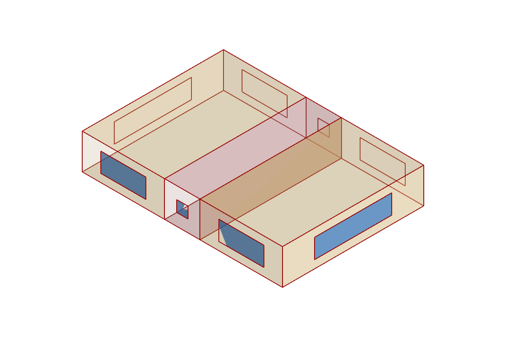

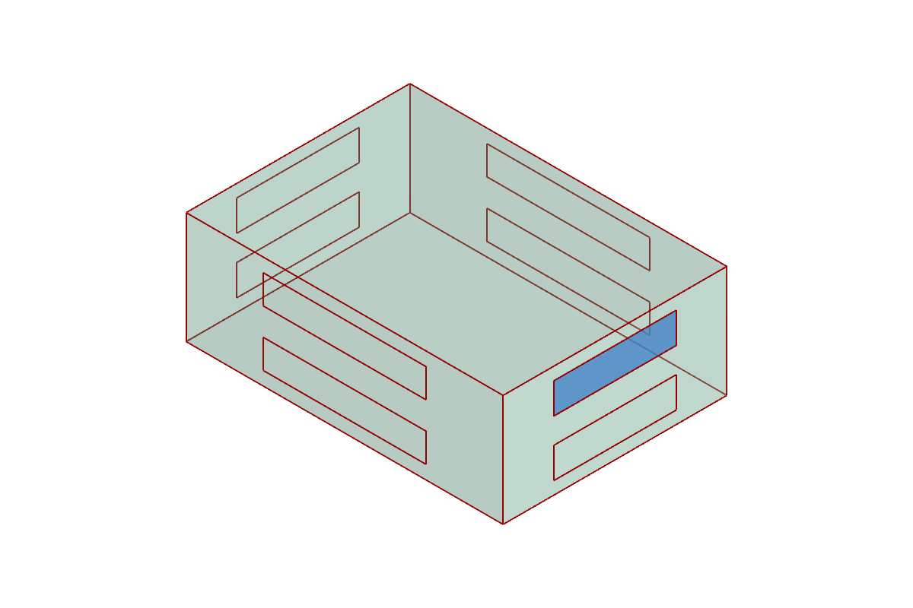

**Example definitions:** `stair-pair.gh` ([canvas](../../assets/screenshots/canvas/stair-pair.png)).

## Stepped Band

Component · nickname `SBand` · GUID `3c685bfb-b45b-45af-98d2-8318a6314922` · exposure primary

Stepped dwelling bands with exposed terraces (SYN-TYP-012): a band of dwellings between a west stair and a rear corridor that steps back storey by storey, so each lower roof keeps a terrace (an outdoor roof); every dwelling adjoins the corridor. One plan per storey, bottom-up; one zone per dwelling and storey. All lengths in metres regardless of model units.

**Inputs**

| Name | Nickname | Type | Access | Optional | Default | Description |
| --- | --- | --- | --- | --- | --- | --- |
| Storey Count | `SC` | Integer | item | no | `3` | Number of storeys; at least 2. Each storey steps back by Step Depth from the one below. |
| Length | `L` | Number | item | no | `36` | Band length along plan x, m. |
| Base Depth | `BD` | Number | item | no | `14` | Dwelling depth on the ground storey, from the south façade to the corridor, m; must exceed (Storey Count - 1) x Step Depth. |
| Step Depth | `SD` | Number | item | no | `3` | Depth by which every storey steps back from the one below, the terrace depth, m. |
| Corridor Width | `CW` | Number | item | no | `2` | Width of the corridor along the band's rear, m. |
| Unit Width | `UW` | Number | item | no | `6` | Target dwelling width, m; the band beside the stair is divided evenly. |
| Stair Width | `SW` | Number | item | no | `4` | Width of the stair at the west end, m. |
| Floor Height | `FH` | Number | item | no | `3` | Floor-to-floor height, m. |
| Orientation | `O` | Number | item | no | `0` | Clockwise rotation of plan north from true north, degrees. |
| Dwelling Unit | `DU` | [Program Preset](info.md#program-preset) | item | no | – | Program preset of the dwellings; space type DwellingUnit. An Any Program Preset is accepted too: its zones keep this space type and take the preset's program, and the plan's provenance records it. |
| Corridor | `Co` | [Program Preset](info.md#program-preset) | item | no | – | Program preset of the rear corridor; space type Corridor. An Any Program Preset is accepted too: its zones keep this space type and take the preset's program, and the plan's provenance records it. |
| Stair | `St` | [Program Preset](info.md#program-preset) | item | no | – | Program preset of the stair; space type Stair. An Any Program Preset is accepted too: its zones keep this space type and take the preset's program, and the plan's provenance records it. |
| Preview Location | `PL` | Vector | item | yes | `{0,0,0}` | Moves this component's viewport preview by this vector, in model units; the data and all outputs keep their true coordinates. |

**Outputs**

| Name | Nickname | Type | Access | Description |
| --- | --- | --- | --- | --- |
| Plan | `Plan` | [Plan](info.md#plan) | list | The detailed plan of every storey, bottom-up. Wire it through a plan simplifier into a floor aggregator's Floors, with Multipliers unconnected (one storey each). |

**Screenshots** of the example `stepped-band.gh`: the plan preview and the building preview.

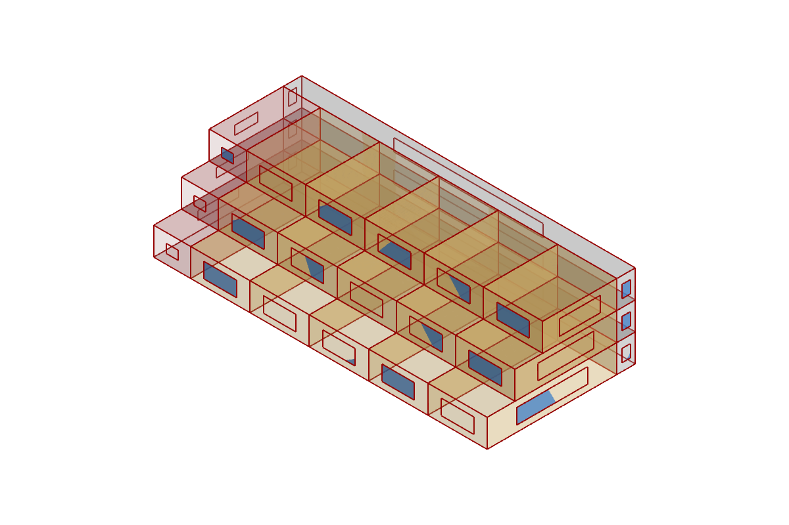

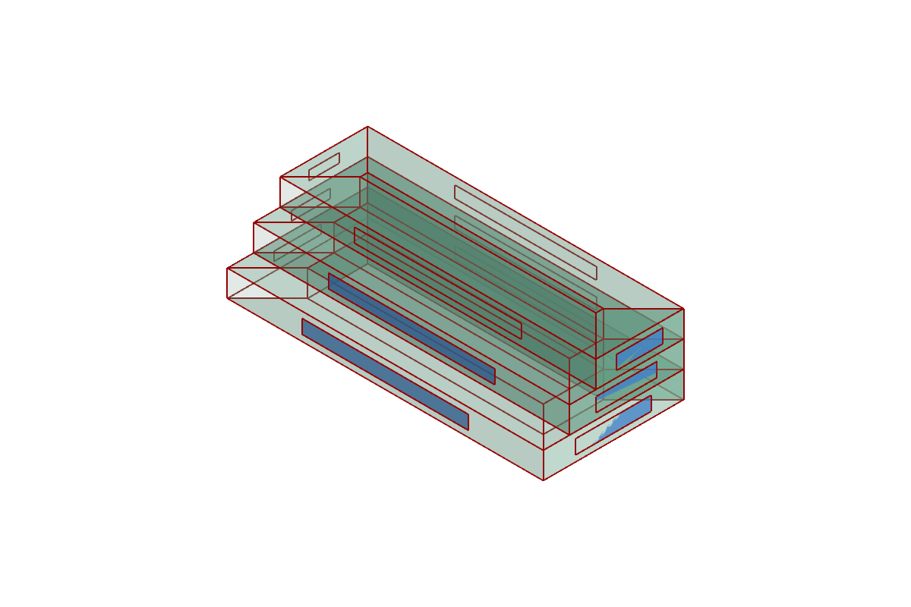

**Example definitions:** `stepped-band.gh` ([canvas](../../assets/screenshots/canvas/stepped-band.png)).

## Terrace Row

Component · nickname `Terr` · GUID `f694e595-dba2-4b98-9d1e-f1492e3edf39` · exposure primary

Attached narrow terrace row (HDHM-TYP-006): a row of attached house plots sharing dividing walls, one dwelling zone per plot and storey; each house's own stair is inside the dwelling and not zoned. All lengths in metres regardless of model units.

**Inputs**

| Name | Nickname | Type | Access | Optional | Default | Description |
| --- | --- | --- | --- | --- | --- | --- |
| Plot Count | `PC` | Integer | item | no | `6` | Number of attached house plots along the row; at least 2. |
| Plot Width | `PW` | Number | item | no | `5.5` | Width of each plot along the row, m. |
| Depth | `D` | Number | item | no | `10` | Row depth, which every house spans, m. |
| Floor Height | `FH` | Number | item | no | `3` | Floor-to-floor height, m. |
| Orientation | `O` | Number | item | no | `0` | Clockwise rotation of plan north from true north, degrees. |
| Dwelling Unit | `DU` | [Program Preset](info.md#program-preset) | item | no | – | Program preset of the houses; space type DwellingUnit. An Any Program Preset is accepted too: its zones keep this space type and take the preset's program, and the plan's provenance records it. |
| Preview Location | `PL` | Vector | item | yes | `{0,0,0}` | Moves this component's viewport preview by this vector, in model units; the data and all outputs keep their true coordinates. |

**Outputs**

| Name | Nickname | Type | Access | Description |
| --- | --- | --- | --- | --- |
| Plan | `Plan` | [Plan](info.md#plan) | item | The detailed plan. |

**Screenshots** of the example `terrace-row.gh`: the plan preview and the building preview.

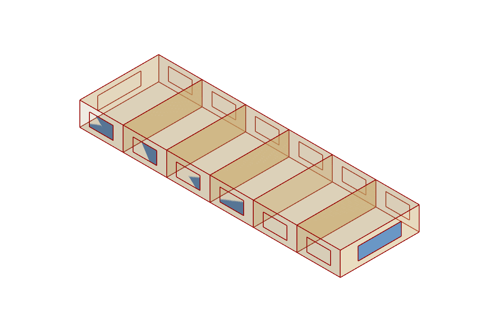

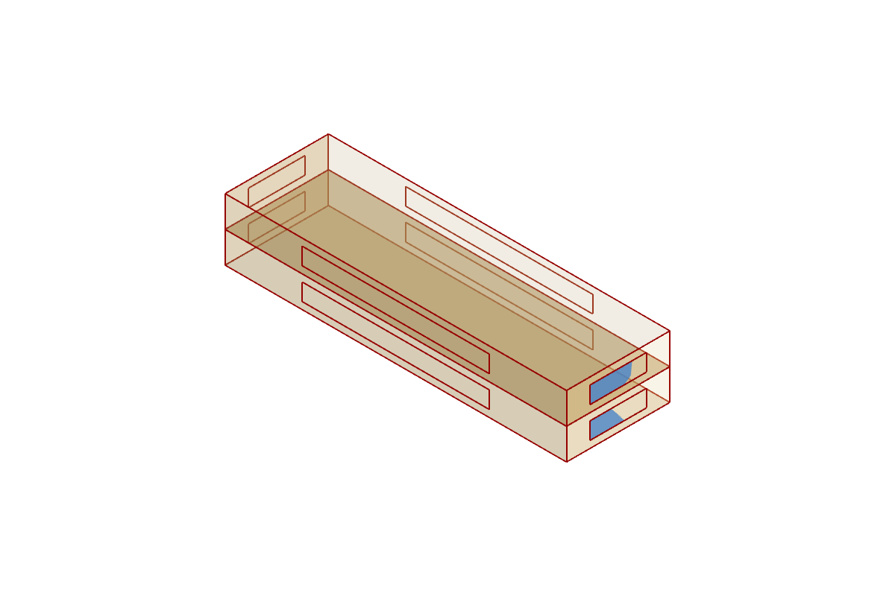

**Example definitions:** `terrace-row.gh` ([canvas](../../assets/screenshots/canvas/terrace-row.png)).

## Transform Plan

Component · nickname `TPlan` · GUID `57c17b9c-04b4-4595-9150-bb923877d95e` · exposure primary

Rotates a plan about the world z axis and moves it in the world x-y plane. Any other part of the transform (z translation, rotation about another axis, scaling, shear, mirroring, projection) is not applied and gives a warning. Storey elevations come from the floor aggregator.

**Inputs**

| Name | Nickname | Type | Access | Optional | Default | Description |
| --- | --- | --- | --- | --- | --- | --- |
| Plan | `Plan` | [Plan](info.md#plan) | item | no | – | The plan to move. |
| Transform | `T` | Transform | item | no | – | Rotation about the world z axis and translation in x and y, in model units; other parts are not applied. |
| Preview Location | `PL` | Vector | item | yes | `{0,0,0}` | Moves this component's viewport preview by this vector, in model units; the data and all outputs keep their true coordinates. |

**Outputs**

| Name | Nickname | Type | Access | Description |
| --- | --- | --- | --- | --- |
| Plan | `Plan` | [Plan](info.md#plan) | item | The moved plan. |

## Winged Band

Component · nickname `WBand` · GUID `e285811d-2fdb-4d31-8b02-62c270b609cf` · exposure primary

Projecting wings joined by a common band (HDHM-TYP-003): a band of stair bays with wings of stair bays projecting to plan north, each joined to the band along its whole root; the comb outline gives the band short façade fragments between the wings. One zone per dwelling unit. All lengths in metres regardless of model units.

**Inputs**

| Name | Nickname | Type | Access | Optional | Default | Description |
| --- | --- | --- | --- | --- | --- | --- |
| Wing Count | `WC` | Integer | item | no | `3` | Number of wings projecting from the band; at least 2. |
| Wing Length | `WL` | Number | item | no | `17` | Length of each wing from the band to its tip, m. |
| Wing Spacing | `WS` | Number | item | no | `17` | Clear distance between neighbouring wings along the band, m. |
| Depth | `D` | Number | item | no | `12` | Depth of the band and of every wing, which every dwelling and stair spans, m. |
| Unit Width | `UW` | Number | item | no | `7` | Target dwelling width, m; adjusted so the stair bays fill the band and each wing exactly. |
| Stair Width | `SW` | Number | item | no | `3` | Width of each stair along the band and the wings, m. |
| Floor Height | `FH` | Number | item | no | `3` | Floor-to-floor height, m. |
| Orientation | `O` | Number | item | no | `0` | Clockwise rotation of plan north from true north, degrees. |
| Dwelling Unit | `DU` | [Program Preset](info.md#program-preset) | item | no | – | Program preset of the dwellings; space type DwellingUnit. An Any Program Preset is accepted too: its zones keep this space type and take the preset's program, and the plan's provenance records it. |
| Stair | `St` | [Program Preset](info.md#program-preset) | item | no | – | Program preset of the stairs; space type Stair. An Any Program Preset is accepted too: its zones keep this space type and take the preset's program, and the plan's provenance records it. |
| Preview Location | `PL` | Vector | item | yes | `{0,0,0}` | Moves this component's viewport preview by this vector, in model units; the data and all outputs keep their true coordinates. |

**Outputs**

| Name | Nickname | Type | Access | Description |
| --- | --- | --- | --- | --- |
| Plan | `Plan` | [Plan](info.md#plan) | item | The detailed plan. |

**Screenshots** of the example `winged-band.gh`: the plan preview and the building preview.

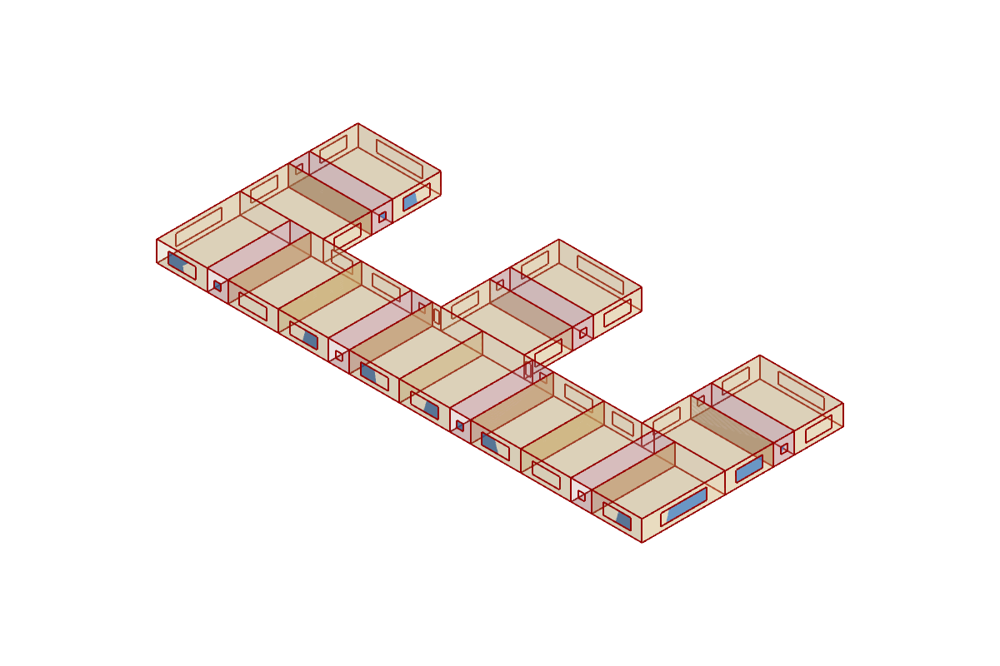

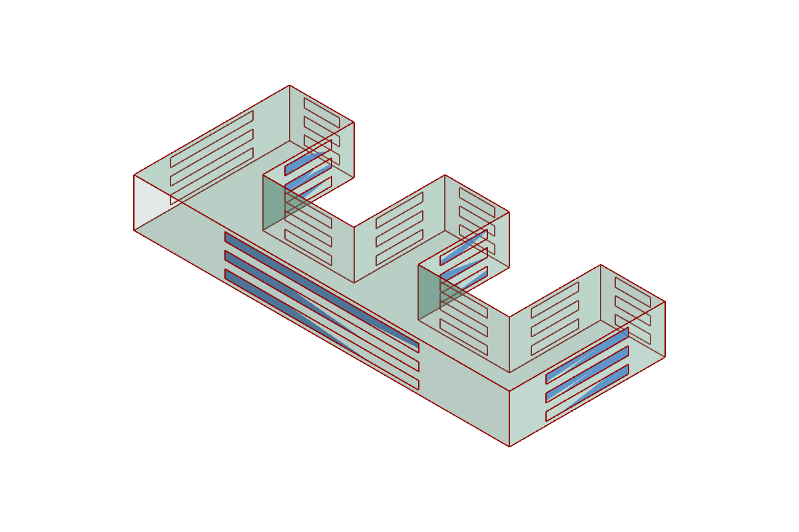

**Example definitions:** `winged-band.gh` ([canvas](../../assets/screenshots/canvas/winged-band.png)).

## DOE Full-Service Restaurant

Component · nickname `DoeFSR` · GUID `b4ca8365-a4dc-4af7-a6b5-0fc68cdb37a9` · exposure secondary

The DOE full-service restaurant: a 16.44 m deep dining room and a 6.17 m deep kitchen on a 22.61 m square plate. One storey: the dining room along the south façade and the kitchen behind it, each the plate's length; every dimension is a band its input sets, at least 0.5 m (G2: a flat roof at the zone top). All lengths in metres regardless of model units. A DOE generator's zones are the DOE zones; each takes the preset of its program key, its standards space type, from the Program Map.

**Inputs**

| Name | Nickname | Type | Access | Optional | Default | Description |
| --- | --- | --- | --- | --- | --- | --- |
| Length | `L` | Number | item | yes | `22.6087` | Plate length along plan x, m; at least 0.5 m. |
| Dining Depth | `DD` | Number | item | yes | `16.4427` | Depth of the dining room along plan y, m; at least 0.5 m. The plate depth is Dining Depth + Kitchen Depth. |
| Kitchen Depth | `KD` | Number | item | yes | `6.166` | Depth of the kitchen along plan y, m; at least 0.5 m, and it may exceed the dining room's. |
| Floor Height | `FH` | Number | item | yes | `3.0488` | Floor-to-floor height, m. |
| Orientation | `O` | Number | item | yes | `0` | Clockwise rotation of plan north from true north, degrees. |
| Program Map | `Map` | [Program Map](info.md#program-map) | item | yes | – | A DOE Program Map with one preset per program key of the plans (see Program Keys); a key without a preset is MissingPreset. |
| Preview Location | `PL` | Vector | item | yes | `{0,0,0}` | Moves this component's viewport preview by this vector, in model units; the data and all outputs keep their true coordinates. |

**Outputs**

| Name | Nickname | Type | Access | Description |
| --- | --- | --- | --- | --- |
| Plan | `Plan` | [Plan](info.md#plan) | list | The detailed plan of every storey, bottom-up. Wire it through a plan simplifier into a floor aggregator's Floors, and Multipliers into its Multipliers. |
| Multipliers | `N` | Integer | list | How many storeys each plan stands for, bottom-up: the floor entries' multipliers. Wire it into the floor aggregator's Multipliers beside the floors made from Plan. |
| Program Keys | `Keys` | Text | list | Every program key of the plans (standards space types), in ordinal order: the keys the Program Map needs. Given even without a Program Map. |

## DOE Hospital

Component · nickname `DoeHosp` · GUID `da2d1dab-1994-420f-87d6-8cae8ea567a4` · exposure secondary

The DOE hospital: five storeys of 9, 11, 13, 13, and 8 zones; its 17 repeated rooms are drawn once with their multiplier on a plate whose copy space holds their copies (G3: no basement). The sizes vary by the S3 rule: the corridor bands keep the width Corridor Width gives them, and the other intervals take the plate's length and depth. All lengths in metres regardless of model units. A DOE generator's zones are the DOE zones; each takes the preset of its program key, its standards space type, from the Program Map.

**Inputs**

| Name | Nickname | Type | Access | Optional | Default | Description |
| --- | --- | --- | --- | --- | --- | --- |
| Room Multipliers | `RM` | Integer | list | yes | `4`, `4`, `4`, `4`, `5`, `6`, `5`, `10`, `10`, `10`, `10`, `10`, `10`, `10`, `10`, `5`, `6` | How many rooms each repeated room stands for, 17 values, each at least 2, in this order: 0: ER_Exam1_Mult4_Flr_1, 1: ER_Exam3_Mult4_Flr_1, 2: ER_Triage_Mult4_Flr_1, 3: Office1_Mult4_Flr_1, 4: IC_PatRoom1_Mult5_Flr_2, 5: IC_PatRoom3_Mult6_Flr_2, 6: OR2_Mult5_Flr_2, 7: PatRoom1_Mult10_Flr_3, 8: PatRoom3_Mult10_Flr_3, 9: PatRoom5_Mult10_Flr_3, 10: PatRoom7_Mult10_Flr_3, 11: PatRoom1_Mult10_Flr_4, 12: PatRoom3_Mult10_Flr_4, 13: PatRoom5_Mult10_Flr_4, 14: PatRoom7_Mult10_Flr_4, 15: Office2_Mult5_Flr_5, 16: Office4_Mult6_Flr_5. The drawing is unchanged. |
| Plate Length | `L` | Number | item | yes | `70.104` | Plate length along plan x, m; at least 35.908 m at the default corridor width. |
| Plate Depth | `D` | Number | item | yes | `53.34` | Plate depth along plan y, m; at least 24.192 m at the default corridor width. |
| Corridor Width | `CW` | Number | item | yes | `4.572` | Width of the narrowest corridor leg, the patient floors' west and east corridors, m; every corridor band scales with it; from 0.5 m to 10.607 m at the default plate. |
| Floor Height | `FH` | Number | item | yes | `4.2683` | Floor-to-floor height, m. |
| Orientation | `O` | Number | item | yes | `0` | Clockwise rotation of plan north from true north, degrees. |
| Program Map | `Map` | [Program Map](info.md#program-map) | item | yes | – | A DOE Program Map with one preset per program key of the plans (see Program Keys); a key without a preset is MissingPreset. |
| Preview Location | `PL` | Vector | item | yes | `{0,0,0}` | Moves this component's viewport preview by this vector, in model units; the data and all outputs keep their true coordinates. |

**Outputs**

| Name | Nickname | Type | Access | Description |
| --- | --- | --- | --- | --- |
| Plan | `Plan` | [Plan](info.md#plan) | list | The detailed plan of every storey, bottom-up. Wire it through a plan simplifier into a floor aggregator's Floors, and Multipliers into its Multipliers. |
| Multipliers | `N` | Integer | list | How many storeys each plan stands for, bottom-up: the floor entries' multipliers. Wire it into the floor aggregator's Multipliers beside the floors made from Plan. |
| Program Keys | `Keys` | Text | list | Every program key of the plans (standards space types), in ordinal order: the keys the Program Map needs. Given even without a Program Map. |

## DOE Large Hotel

Component · nickname `DoeLHtl` · GUID `8b61c4c7-2d19-4a1a-b83d-cea9254b634a` · exposure secondary

The DOE large hotel: a ground storey, a typical guest-room floor that stands for the storeys between it and the top storey (x4 by default), and the top storey, 7 zones each; the repeated guest rooms are drawn once with their multiplier on a plate whose copy space holds their copies (G3: no basement; G5: one floor height, the typical floor's). The sizes vary by the S3 rule: Length changes only the run of copies, Depth keeps the typical corridor band. All lengths in metres regardless of model units. A DOE generator's zones are the DOE zones; each takes the preset of its program key, its standards space type, from the Program Map.

**Inputs**

| Name | Nickname | Type | Access | Optional | Default | Description |
| --- | --- | --- | --- | --- | --- | --- |
| Storeys | `S` | Integer | item | yes | `6` | Number of storeys; at least 3. The ground and top plans stand for one storey each, the typical plan for the rest (Multipliers). |
| Guest Rooms Per Row | `R` | Integer | item | yes | `19` | How many guest rooms each of the typical floor's two repeated room zones stands for (its zone multiplier); at least 2. The drawing is unchanged; one guest-room bay (3.657 m) of Length per room added keeps the typical floor's copy space at about the copies' area (within the source's own 0.03 m²). The top storey's room stays x9 while its copy space follows Length. |
| Length | `L` | Number | item | yes | `86.563` | Plate length along plan x, m; at least 30.384 m. Only the run of copies takes the change. |
| Depth | `D` | Number | item | yes | `22.86` | Plate depth along plan y, the ground storey's, m; at least 7.657 m. The typical corridor band keeps its width. |
| Floor Height | `FH` | Number | item | yes | `3.048` | Floor-to-floor height, m. One for every storey (G5); the source's ground storey is 3.962 m. |
| Orientation | `O` | Number | item | yes | `0` | Clockwise rotation of plan north from true north, degrees. |
| Program Map | `Map` | [Program Map](info.md#program-map) | item | yes | – | A DOE Program Map with one preset per program key of the plans (see Program Keys); a key without a preset is MissingPreset. |
| Preview Location | `PL` | Vector | item | yes | `{0,0,0}` | Moves this component's viewport preview by this vector, in model units; the data and all outputs keep their true coordinates. |

**Outputs**

| Name | Nickname | Type | Access | Description |
| --- | --- | --- | --- | --- |
| Plan | `Plan` | [Plan](info.md#plan) | list | The detailed plan of every storey, bottom-up. Wire it through a plan simplifier into a floor aggregator's Floors, and Multipliers into its Multipliers. |
| Multipliers | `N` | Integer | list | How many storeys each plan stands for, bottom-up: the floor entries' multipliers. Wire it into the floor aggregator's Multipliers beside the floors made from Plan. |
| Program Keys | `Keys` | Text | list | Every program key of the plans (standards space types), in ordinal order: the keys the Program Map needs. Given even without a Program Map. |

## DOE Large Office

Component · nickname `DoeLOff` · GUID `8bb8e1b0-83e8-4cdf-b36b-3364315e6006` · exposure secondary

The DOE large office: a ground, a middle (x10 by default), and a top storey of 26 rooms each, data centre included (G1: each zone one floor-to-floor high, its plenum inside; G3: no basement). The openstudio-standards detailed office rooms on the DOE reference plate and elevations; the sizes vary by the S3 rule: the perimeter rooms and the corridor ring keep the depth and width given, and the core absorbs the plate's length and depth, each core interval at least 1 m. All lengths in metres regardless of model units. A DOE generator's zones are the DOE zones; each takes the preset of its program key, its standards space type, from the Program Map.

**Inputs**

| Name | Nickname | Type | Access | Optional | Default | Description |
| --- | --- | --- | --- | --- | --- | --- |
| Storeys | `S` | Integer | item | yes | `12` | Number of storeys; at least 3. The ground and top plans stand for one storey each, the middle plan for the rest (Multipliers; 10 at the default). |
| Plate Length | `L` | Number | item | yes | `73.10755` | Plate length along plan x, m. |
| Plate Depth | `D` | Number | item | yes | `48.737837` | Plate depth along plan y, m. |
| Perimeter Depth | `PD` | Number | item | yes | `12.161838` | Depth of the top storey's south perimeter rooms, façade to corridor, m; the perimeter rooms of every side and storey scale with it. |
| Corridor Width | `CW` | Number | item | yes | `1.523999` | Width of the top storey's south corridor, m; the corridor ring scales with it. |
| Floor Height | `FH` | Number | item | yes | `3.9632` | Floor-to-floor height, m. Windows are sized below the source ceiling height, 2.744 m at the default, which keeps its share of the floor height (S6). |
| Orientation | `O` | Number | item | yes | `0` | Clockwise rotation of plan north from true north, degrees. |
| Program Map | `Map` | [Program Map](info.md#program-map) | item | yes | – | A DOE Program Map with one preset per program key of the plans (see Program Keys); a key without a preset is MissingPreset. |
| Preview Location | `PL` | Vector | item | yes | `{0,0,0}` | Moves this component's viewport preview by this vector, in model units; the data and all outputs keep their true coordinates. |

**Outputs**

| Name | Nickname | Type | Access | Description |
| --- | --- | --- | --- | --- |
| Plan | `Plan` | [Plan](info.md#plan) | list | The detailed plan of every storey, bottom-up. Wire it through a plan simplifier into a floor aggregator's Floors, and Multipliers into its Multipliers. |
| Multipliers | `N` | Integer | list | How many storeys each plan stands for, bottom-up: the floor entries' multipliers. Wire it into the floor aggregator's Multipliers beside the floors made from Plan. |
| Program Keys | `Keys` | Text | list | Every program key of the plans (standards space types), in ordinal order: the keys the Program Map needs. Given even without a Program Map. |

## DOE Medium Office

Component · nickname `DoeMOff` · GUID `e7998061-adad-41d7-a08f-aeb372863442` · exposure secondary

The DOE medium office: a ground, a middle, and a top storey of 23, 21, and 21 rooms (G1: each zone one floor-to-floor high, its plenum inside). The openstudio-standards detailed office rooms on the DOE reference plate and elevations; the sizes vary by the S3 rule: the perimeter rooms and the corridor ring keep the depth and width given, and the core absorbs the plate's length and depth, each core interval at least 1 m. All lengths in metres regardless of model units. A DOE generator's zones are the DOE zones; each takes the preset of its program key, its standards space type, from the Program Map.

**Inputs**

| Name | Nickname | Type | Access | Optional | Default | Description |
| --- | --- | --- | --- | --- | --- | --- |
| Storeys | `S` | Integer | item | yes | `3` | Number of storeys; at least 3. The ground and top plans stand for one storey each, the middle plan for the rest (Multipliers). |
| Plate Length | `L` | Number | item | yes | `49.911` | Plate length along plan x, m. |
| Plate Depth | `D` | Number | item | yes | `33.274` | Plate depth along plan y, m. |
| Perimeter Depth | `PD` | Number | item | yes | `5.341938` | Depth of the top storey's south perimeter rooms, façade to corridor, m; the perimeter rooms of every side and storey scale with it. |
| Corridor Width | `CW` | Number | item | yes | `1.2192` | Width of the top storey's south corridor, m; the corridor ring scales with it. |
| Floor Height | `FH` | Number | item | yes | `3.9624` | Floor-to-floor height, m. Windows are sized below the source ceiling height, 2.7432 m at the default, which keeps its share of the floor height (S6). |
| Orientation | `O` | Number | item | yes | `0` | Clockwise rotation of plan north from true north, degrees. |
| Program Map | `Map` | [Program Map](info.md#program-map) | item | yes | – | A DOE Program Map with one preset per program key of the plans (see Program Keys); a key without a preset is MissingPreset. |
| Preview Location | `PL` | Vector | item | yes | `{0,0,0}` | Moves this component's viewport preview by this vector, in model units; the data and all outputs keep their true coordinates. |

**Outputs**

| Name | Nickname | Type | Access | Description |
| --- | --- | --- | --- | --- |
| Plan | `Plan` | [Plan](info.md#plan) | list | The detailed plan of every storey, bottom-up. Wire it through a plan simplifier into a floor aggregator's Floors, and Multipliers into its Multipliers. |
| Multipliers | `N` | Integer | list | How many storeys each plan stands for, bottom-up: the floor entries' multipliers. Wire it into the floor aggregator's Multipliers beside the floors made from Plan. |
| Program Keys | `Keys` | Text | list | Every program key of the plans (standards space types), in ordinal order: the keys the Program Map needs. Given even without a Program Map. |

**Example definitions:** `doe-atlas-map.gh` ([canvas](../../assets/screenshots/canvas/doe-atlas-map.png)).

## DOE Outpatient

Component · nickname `DoeOutP` · GUID `5d0c7a3e-9b41-4f6e-a8d2-3c1e7b590f64` · exposure secondary

The DOE outpatient health-care building: three storeys of 59, 41, and 26 zones, one plan per storey (G4: the stairs and the lift, which span the three storeys in the source, are one zone per storey). The sizes vary by the S3 rule: the corridor strips keep the width Corridor Width gives them, intervals under 1 m keep theirs, and the other intervals share the plate's length and depth by their slack, each at least 1 m. All lengths in metres regardless of model units. A DOE generator's zones are the DOE zones; each takes the preset of its program key, its standards space type, from the Program Map.

**Inputs**

| Name | Nickname | Type | Access | Optional | Default | Description |
| --- | --- | --- | --- | --- | --- | --- |
| Plate Length | `L` | Number | item | yes | `51.816` | Plate length along plan x, m; at least 34.9832 m with the default corridors. |
| Plate Depth | `D` | Number | item | yes | `35.3568` | Plate depth along plan y (the ground storey's), m; at least 26.3736 m with the default corridors. |
| Corridor Width | `CW` | Number | item | yes | `1.8288` | Width of the most common corridor, m; every corridor strip scales with it; from 0.6 to 3.7538 m on the default plate. |
| Floor Height | `FH` | Number | item | yes | `3.048` | Floor-to-floor height, m. |
| Orientation | `O` | Number | item | yes | `0` | Clockwise rotation of plan north from true north, degrees. |
| Program Map | `Map` | [Program Map](info.md#program-map) | item | yes | – | A DOE Program Map with one preset per program key of the plans (see Program Keys); a key without a preset is MissingPreset. |
| Preview Location | `PL` | Vector | item | yes | `{0,0,0}` | Moves this component's viewport preview by this vector, in model units; the data and all outputs keep their true coordinates. |

**Outputs**

| Name | Nickname | Type | Access | Description |
| --- | --- | --- | --- | --- |
| Plan | `Plan` | [Plan](info.md#plan) | list | The detailed plan of every storey, bottom-up. Wire it through a plan simplifier into a floor aggregator's Floors, and Multipliers into its Multipliers. |
| Multipliers | `N` | Integer | list | How many storeys each plan stands for, bottom-up: the floor entries' multipliers. Wire it into the floor aggregator's Multipliers beside the floors made from Plan. |
| Program Keys | `Keys` | Text | list | Every program key of the plans (standards space types), in ordinal order: the keys the Program Map needs. Given even without a Program Map. |

## DOE Primary School

Component · nickname `DoePSch` · GUID `4f67ab4c-7c7e-4a27-afbe-8e76cd48097d` · exposure secondary

The DOE primary school: one storey of 25 zones, three classroom wings, and the gym's skylights from its preset. Classroom wings (a classroom row, a corridor, a classroom row) west of a spine of shared rooms, the wings apart by courts open to the west. The sizes vary by the S3 rule: the corridors and classroom rows take the width and depth given, the courts keep theirs, and the spine moves with the wings. All lengths in metres regardless of model units. A DOE generator's zones are the DOE zones; each takes the preset of its program key, its standards space type, from the Program Map.

**Inputs**

| Name | Nickname | Type | Access | Optional | Default | Description |
| --- | --- | --- | --- | --- | --- | --- |
| Wing Count | `W` | Integer | item | yes | `3` | Classroom wings, south to north; at least 2. The first and the last are the source's; each between them repeats its middle wing with the court after it. |
| Length | `L` | Number | item | yes | `104` | Plate length along plan x, m; the main corridor's column keeps its width and the other columns share the change. At least 18 m. |
| Corridor Width | `CW` | Number | item | yes | `3` | Width of every wing's corridor, m; at least 0.5 m. |
| Classroom Depth | `CD` | Number | item | yes | `9` | Depth of every classroom row of every wing, corridor to façade, m; at least 2 m from three wings up (the middle wing's rows hold the spine's walls, 1 m per interval), at least 0.5 m at two wings. |
| Floor Height | `FH` | Number | item | yes | `4` | Floor-to-floor height, m. |
| Orientation | `O` | Number | item | yes | `0` | Clockwise rotation of plan north from true north, degrees. |
| Program Map | `Map` | [Program Map](info.md#program-map) | item | yes | – | A DOE Program Map with one preset per program key of the plans (see Program Keys); a key without a preset is MissingPreset. |
| Preview Location | `PL` | Vector | item | yes | `{0,0,0}` | Moves this component's viewport preview by this vector, in model units; the data and all outputs keep their true coordinates. |

**Outputs**

| Name | Nickname | Type | Access | Description |
| --- | --- | --- | --- | --- |
| Plan | `Plan` | [Plan](info.md#plan) | list | The detailed plan of every storey, bottom-up. Wire it through a plan simplifier into a floor aggregator's Floors, and Multipliers into its Multipliers. |
| Multipliers | `N` | Integer | list | How many storeys each plan stands for, bottom-up: the floor entries' multipliers. Wire it into the floor aggregator's Multipliers beside the floors made from Plan. |
| Program Keys | `Keys` | Text | list | Every program key of the plans (standards space types), in ordinal order: the keys the Program Map needs. Given even without a Program Map. |

## DOE Quick-Service Restaurant

Component · nickname `DoeQSR` · GUID `cf72627b-3035-4f91-858c-f51772989c07` · exposure secondary

The DOE quick-service restaurant: a dining room and a kitchen, both 7.62 m deep, on a 15.24 m square plate. One storey: the dining room along the south façade and the kitchen behind it, each the plate's length; every dimension is a band its input sets, at least 0.5 m (G2: a flat roof at the zone top). All lengths in metres regardless of model units. A DOE generator's zones are the DOE zones; each takes the preset of its program key, its standards space type, from the Program Map.

**Inputs**

| Name | Nickname | Type | Access | Optional | Default | Description |
| --- | --- | --- | --- | --- | --- | --- |
| Length | `L` | Number | item | yes | `15.2428` | Plate length along plan x, m; at least 0.5 m. |
| Dining Depth | `DD` | Number | item | yes | `7.6214` | Depth of the dining room along plan y, m; at least 0.5 m. The plate depth is Dining Depth + Kitchen Depth. |
| Kitchen Depth | `KD` | Number | item | yes | `7.6214` | Depth of the kitchen along plan y, m; at least 0.5 m, and it may exceed the dining room's. |
| Floor Height | `FH` | Number | item | yes | `3.0488` | Floor-to-floor height, m. |
| Orientation | `O` | Number | item | yes | `0` | Clockwise rotation of plan north from true north, degrees. |
| Program Map | `Map` | [Program Map](info.md#program-map) | item | yes | – | A DOE Program Map with one preset per program key of the plans (see Program Keys); a key without a preset is MissingPreset. |
| Preview Location | `PL` | Vector | item | yes | `{0,0,0}` | Moves this component's viewport preview by this vector, in model units; the data and all outputs keep their true coordinates. |

**Outputs**

| Name | Nickname | Type | Access | Description |
| --- | --- | --- | --- | --- |
| Plan | `Plan` | [Plan](info.md#plan) | list | The detailed plan of every storey, bottom-up. Wire it through a plan simplifier into a floor aggregator's Floors, and Multipliers into its Multipliers. |
| Multipliers | `N` | Integer | list | How many storeys each plan stands for, bottom-up: the floor entries' multipliers. Wire it into the floor aggregator's Multipliers beside the floors made from Plan. |
| Program Keys | `Keys` | Text | list | Every program key of the plans (standards space types), in ordinal order: the keys the Program Map needs. Given even without a Program Map. |

## DOE Secondary School

Component · nickname `DoeSSch` · GUID `913bc6e4-ba40-4f81-949d-fc7d616ee1db` · exposure secondary

The DOE secondary school: two storeys of 25 and 21 zones, three classroom wings on each (G4: the gym, auxiliary gym, and auditorium, 8 m high in the source, take the storey height on the ground storey). Classroom wings (a classroom row, a corridor, a classroom row) west of a spine of shared rooms, the wings apart by courts open to the west. The sizes vary by the S3 rule: the corridors and classroom rows take the width and depth given, the courts keep theirs, and the spine moves with the wings. All lengths in metres regardless of model units. A DOE generator's zones are the DOE zones; each takes the preset of its program key, its standards space type, from the Program Map.

**Inputs**

| Name | Nickname | Type | Access | Optional | Default | Description |
| --- | --- | --- | --- | --- | --- | --- |
| Wing Count | `W` | Integer | item | yes | `3` | Classroom wings, south to north; at least 2. The first and the last are the source's; each between them repeats its middle wing with the court after it. |
| Length | `L` | Number | item | yes | `141` | Plate length along plan x, m; the main corridor's column keeps its width and the other columns share the change. At least 19 m. |
| Corridor Width | `CW` | Number | item | yes | `5` | Width of every wing's corridor, m; at least 0.5 m. |
| Classroom Depth | `CD` | Number | item | yes | `9` | Depth of every classroom row of every wing, corridor to façade, m; at least 2 m at every wing count (the last wing's row holds the spine's walls, 1 m per interval). |
| Floor Height | `FH` | Number | item | yes | `4` | Floor-to-floor height, m. |
| Orientation | `O` | Number | item | yes | `0` | Clockwise rotation of plan north from true north, degrees. |
| Program Map | `Map` | [Program Map](info.md#program-map) | item | yes | – | A DOE Program Map with one preset per program key of the plans (see Program Keys); a key without a preset is MissingPreset. |
| Preview Location | `PL` | Vector | item | yes | `{0,0,0}` | Moves this component's viewport preview by this vector, in model units; the data and all outputs keep their true coordinates. |

**Outputs**

| Name | Nickname | Type | Access | Description |
| --- | --- | --- | --- | --- |
| Plan | `Plan` | [Plan](info.md#plan) | list | The detailed plan of every storey, bottom-up. Wire it through a plan simplifier into a floor aggregator's Floors, and Multipliers into its Multipliers. |
| Multipliers | `N` | Integer | list | How many storeys each plan stands for, bottom-up: the floor entries' multipliers. Wire it into the floor aggregator's Multipliers beside the floors made from Plan. |
| Program Keys | `Keys` | Text | list | Every program key of the plans (standards space types), in ordinal order: the keys the Program Map needs. Given even without a Program Map. |

## DOE Small Hotel

Component · nickname `DoeSHot` · GUID `7b31e279-617d-4a06-a7c9-e8824b7ae396` · exposure secondary

The DOE small hotel: a double-loaded bar of four storeys of 19, 16, 16, and 16 zones, its ground storey with the lobby, lounges, and services (G5: every storey the typical upper storey's height, the source's ground storey 3.3528 m). The sizes vary by the S3 rule: the stairs, storage, lift lobby, and lift keep their length and the guest-room bays share the rest equally, each at least 1 m; the guest-room rows and the corridor are at least 0.5 m. All lengths in metres regardless of model units. A DOE generator's zones are the DOE zones; each takes the preset of its program key, its standards space type, from the Program Map.

**Inputs**

| Name | Nickname | Type | Access | Optional | Default | Description |
| --- | --- | --- | --- | --- | --- | --- |
| Storeys | `S` | Integer | item | yes | `4` | Number of storeys; at least 2. The record's storeys come first; every storey above them repeats its top storey (zone IDs ending _Flr5, _Flr6, ...). |
| Guest Room Bays | `B` | Integer | item | yes | `11` | Guest-room bays along the bar; at least 9, at most one per metre of the length less the stairs, storage, lift lobby, and lift. They share the length equally; the count changes the source's run of three bays west of the lift lobby. |
| Length | `L` | Number | item | yes | `54.8646` | Bar length along plan x, m; at least the 11.278 m of stairs, storage, lift lobby, and lift plus 1 m per bay. |
| Room Depth | `RD` | Number | item | yes | `8.2299` | Depth of the guest-room rows, corridor to façade, m: the mean of the two rows, which keep the source's ratio; each row at least 0.5 m. |
| Corridor Width | `CW` | Number | item | yes | `1.8288` | Width of the corridor along the bar, m; at least 0.5 m. |
| Floor Height | `FH` | Number | item | yes | `2.7432` | Floor-to-floor height, m. One height for every storey (G5). |
| Orientation | `O` | Number | item | yes | `0` | Clockwise rotation of plan north from true north, degrees. |
| Program Map | `Map` | [Program Map](info.md#program-map) | item | yes | – | A DOE Program Map with one preset per program key of the plans (see Program Keys); a key without a preset is MissingPreset. |
| Preview Location | `PL` | Vector | item | yes | `{0,0,0}` | Moves this component's viewport preview by this vector, in model units; the data and all outputs keep their true coordinates. |

**Outputs**

| Name | Nickname | Type | Access | Description |
| --- | --- | --- | --- | --- |
| Plan | `Plan` | [Plan](info.md#plan) | list | The detailed plan of every storey, bottom-up. Wire it through a plan simplifier into a floor aggregator's Floors, and Multipliers into its Multipliers. |
| Multipliers | `N` | Integer | list | How many storeys each plan stands for, bottom-up: the floor entries' multipliers. Wire it into the floor aggregator's Multipliers beside the floors made from Plan. |
| Program Keys | `Keys` | Text | list | Every program key of the plans (standards space types), in ordinal order: the keys the Program Map needs. Given even without a Program Map. |

## DOE Small Office

Component · nickname `DoeSOff` · GUID `c8f1e87b-b238-4b4f-a6de-c510d1e5d02b` · exposure secondary

The DOE small office: one storey of 17 rooms around a corridor ring (G2: a flat roof at the zone top). The openstudio-standards detailed office rooms on the DOE reference plate and elevations; the sizes vary by the S3 rule: the perimeter rooms and the corridor ring keep the depth and width given, and the core absorbs the plate's length and depth, each core interval at least 1 m. All lengths in metres regardless of model units. A DOE generator's zones are the DOE zones; each takes the preset of its program key, its standards space type, from the Program Map.

**Inputs**

| Name | Nickname | Type | Access | Optional | Default | Description |
| --- | --- | --- | --- | --- | --- | --- |
| Storeys | `S` | Integer | item | yes | `1` | Number of storeys; at least 1. The one plan stands for every storey (Multipliers). |
| Plate Length | `L` | Number | item | yes | `27.690763` | Plate length along plan x, m. |
| Plate Depth | `D` | Number | item | yes | `18.45945` | Plate depth along plan y, m. |
| Perimeter Depth | `PD` | Number | item | yes | `4.572` | Depth of the top storey's south perimeter rooms, façade to corridor, m; the perimeter rooms of every side and storey scale with it. |
| Corridor Width | `CW` | Number | item | yes | `1.2192` | Width of the top storey's south corridor, m; the corridor ring scales with it. |
| Floor Height | `FH` | Number | item | yes | `3.05` | Floor-to-floor height, m. |
| Orientation | `O` | Number | item | yes | `0` | Clockwise rotation of plan north from true north, degrees. |
| Program Map | `Map` | [Program Map](info.md#program-map) | item | yes | – | A DOE Program Map with one preset per program key of the plans (see Program Keys); a key without a preset is MissingPreset. |
| Preview Location | `PL` | Vector | item | yes | `{0,0,0}` | Moves this component's viewport preview by this vector, in model units; the data and all outputs keep their true coordinates. |

**Outputs**

| Name | Nickname | Type | Access | Description |
| --- | --- | --- | --- | --- |
| Plan | `Plan` | [Plan](info.md#plan) | list | The detailed plan of every storey, bottom-up. Wire it through a plan simplifier into a floor aggregator's Floors, and Multipliers into its Multipliers. |
| Multipliers | `N` | Integer | list | How many storeys each plan stands for, bottom-up: the floor entries' multipliers. Wire it into the floor aggregator's Multipliers beside the floors made from Plan. |
| Program Keys | `Keys` | Text | list | Every program key of the plans (standards space types), in ordinal order: the keys the Program Map needs. Given even without a Program Map. |

## DOE Stand-alone Retail

Component · nickname `DoeRet` · GUID `1bf76d74-0917-4acc-8d9c-e0eaa36adcbe` · exposure secondary

The DOE stand-alone retail: one storey, a front band along the south façade (point of sale, a centred entry, front retail), the core retail behind it reaching the back of the entry, and a back space along the north façade. The bands keep the depths and width given (at least 0.5 m); the core and the two front zones beside the entry absorb the plate's length and depth by the S3 rule, each at least 1 m. All lengths in metres regardless of model units. A DOE generator's zones are the DOE zones; each takes the preset of its program key, its standards space type, from the Program Map.

**Inputs**

| Name | Nickname | Type | Access | Optional | Default | Description |
| --- | --- | --- | --- | --- | --- | --- |
| Length | `L` | Number | item | yes | `54.27` | Plate length along plan x, m; at least Entry Width + 2 m. |
| Depth | `D` | Number | item | yes | `42.27` | Plate depth along plan y, m; at least Front Depth + Back Space Depth + 1 m. |
| Back Space Depth | `BD` | Number | item | yes | `7` | Depth of the back space along the north façade, m; at least 0.5 m. |
| Front Depth | `FD` | Number | item | yes | `6` | Depth of the front band along the south façade, m; at least 0.5 m. The entry takes half of it. |
| Entry Width | `EW` | Number | item | yes | `4` | Width of the entry, centred in the front band, m; at least 0.5 m. |
| Floor Height | `FH` | Number | item | yes | `6.096` | Floor-to-floor height, m. |
| Orientation | `O` | Number | item | yes | `0` | Clockwise rotation of plan north from true north, degrees. |
| Program Map | `Map` | [Program Map](info.md#program-map) | item | yes | – | A DOE Program Map with one preset per program key of the plans (see Program Keys); a key without a preset is MissingPreset. |
| Preview Location | `PL` | Vector | item | yes | `{0,0,0}` | Moves this component's viewport preview by this vector, in model units; the data and all outputs keep their true coordinates. |

**Outputs**

| Name | Nickname | Type | Access | Description |
| --- | --- | --- | --- | --- |
| Plan | `Plan` | [Plan](info.md#plan) | list | The detailed plan of every storey, bottom-up. Wire it through a plan simplifier into a floor aggregator's Floors, and Multipliers into its Multipliers. |
| Multipliers | `N` | Integer | list | How many storeys each plan stands for, bottom-up: the floor entries' multipliers. Wire it into the floor aggregator's Multipliers beside the floors made from Plan. |
| Program Keys | `Keys` | Text | list | Every program key of the plans (standards space types), in ordinal order: the keys the Program Map needs. Given even without a Program Map. |

## DOE Strip Mall

Component · nickname `DoeSMall` · GUID `94be46f9-90c9-49ec-8104-8d572004856e` · exposure secondary

The DOE strip mall: one storey, a row of stores west to east, each the plate's depth. The stores are runs of one size and tenancy, one item of Store Counts, Store Sizes, and Store Tenancies per run; the defaults are the source's ten stores. Every dimension is a band its input sets, at least 0.5 m. All lengths in metres regardless of model units. A DOE generator's zones are the DOE zones; each takes the preset of its program key, its standards space type, from the Program Map.

**Inputs**

| Name | Nickname | Type | Access | Optional | Default | Description |
| --- | --- | --- | --- | --- | --- | --- |
| Store Counts | `C` | Integer | list | yes | `1`, `1`, `3`, `1`, `4` | The number of stores of each run, west to east; each at least 1. |
| Store Sizes | `SZ` | Text | list | yes | `Large`, `Small`, `Small`, `Large`, `Small` | The size of each run's stores: Large or Small, in any case. |
| Store Tenancies | `T` | Integer | list | yes | `1`, `1`, `2`, `3`, `3` | The tenancy of each run's stores: 1, 2, or 3, the program keys Strip mall - type 1, 2, or 3. |
| Depth | `D` | Number | item | yes | `22.86` | Plate depth along plan y, m; at least 0.5 m. |
| Large Store Width | `LW` | Number | item | yes | `15.24` | Width of a large store along plan x, m; at least 0.5 m. |
| Small Store Width | `SW` | Number | item | yes | `7.62` | Width of a small store along plan x, m; at least 0.5 m. |
| Floor Height | `FH` | Number | item | yes | `5.18` | Floor-to-floor height, m. |
| Orientation | `O` | Number | item | yes | `0` | Clockwise rotation of plan north from true north, degrees. |
| Program Map | `Map` | [Program Map](info.md#program-map) | item | yes | – | A DOE Program Map with one preset per program key of the plans (see Program Keys); a key without a preset is MissingPreset. |
| Preview Location | `PL` | Vector | item | yes | `{0,0,0}` | Moves this component's viewport preview by this vector, in model units; the data and all outputs keep their true coordinates. |

**Outputs**

| Name | Nickname | Type | Access | Description |
| --- | --- | --- | --- | --- |
| Plan | `Plan` | [Plan](info.md#plan) | list | The detailed plan of every storey, bottom-up. Wire it through a plan simplifier into a floor aggregator's Floors, and Multipliers into its Multipliers. |
| Multipliers | `N` | Integer | list | How many storeys each plan stands for, bottom-up: the floor entries' multipliers. Wire it into the floor aggregator's Multipliers beside the floors made from Plan. |
| Program Keys | `Keys` | Text | list | Every program key of the plans (standards space types), in ordinal order: the keys the Program Map needs. Given even without a Program Map. |

## DOE Supermarket

Component · nickname `DoeSMkt` · GUID `2f12351b-adfd-40aa-a763-be4394bd814b` · exposure secondary

The DOE supermarket: one storey, produce and the sales floor along the south, the bakery and the deli along the east façade, the dry storage and the office along the north. The back-of-house bands keep the depths given (at least 0.5 m); produce and sales, and bakery and deli, absorb the plate's length and depth by the S3 rule, each at least 1 m. All lengths in metres regardless of model units. A DOE generator's zones are the DOE zones; each takes the preset of its program key, its standards space type, from the Program Map.

**Inputs**

| Name | Nickname | Type | Access | Optional | Default | Description |
| --- | --- | --- | --- | --- | --- | --- |
| Length | `L` | Number | item | yes | `79.1901` | Plate length along plan x, m; at least Preparation Depth + 2 m. |
| Depth | `D` | Number | item | yes | `52.7944` | Plate depth along plan y, m; at least Storage Depth + 2 m. |
| Storage Depth | `SD` | Number | item | yes | `8.975` | Depth of the north band (dry storage and office), m; at least 0.5 m. |
| Preparation Depth | `PD` | Number | item | yes | `9.8988` | Depth of the east band (bakery, deli, and office) from the east façade, m; at least 0.5 m. |
| Floor Height | `FH` | Number | item | yes | `6.096` | Floor-to-floor height, m. |
| Orientation | `O` | Number | item | yes | `0` | Clockwise rotation of plan north from true north, degrees. |
| Program Map | `Map` | [Program Map](info.md#program-map) | item | yes | – | A DOE Program Map with one preset per program key of the plans (see Program Keys); a key without a preset is MissingPreset. |
| Preview Location | `PL` | Vector | item | yes | `{0,0,0}` | Moves this component's viewport preview by this vector, in model units; the data and all outputs keep their true coordinates. |

**Outputs**

| Name | Nickname | Type | Access | Description |
| --- | --- | --- | --- | --- |
| Plan | `Plan` | [Plan](info.md#plan) | list | The detailed plan of every storey, bottom-up. Wire it through a plan simplifier into a floor aggregator's Floors, and Multipliers into its Multipliers. |
| Multipliers | `N` | Integer | list | How many storeys each plan stands for, bottom-up: the floor entries' multipliers. Wire it into the floor aggregator's Multipliers beside the floors made from Plan. |
| Program Keys | `Keys` | Text | list | Every program key of the plans (standards space types), in ordinal order: the keys the Program Map needs. Given even without a Program Map. |

## DOE Warehouse

Component · nickname `DoeWare` · GUID `814d27a4-8483-4aba-bf78-2bf4daa62f46` · exposure secondary

The DOE warehouse: one storey, the office in the south-west corner of a fine-storage band along the south façade, the bulk storage behind it. The office depth and the fine-storage band keep their depths (bands at least 0.5 m); the office and the fine storage beside it share the plate's length, and the bulk storage takes the rest of its depth, by the S3 rule. G4: the office is drawn to the storey height and the fine-storage floor above it is dropped. All lengths in metres regardless of model units. A DOE generator's zones are the DOE zones; each takes the preset of its program key, its standards space type, from the Program Map.

**Inputs**

| Name | Nickname | Type | Access | Optional | Default | Description |
| --- | --- | --- | --- | --- | --- | --- |
| Length | `L` | Number | item | yes | `45.7178` | Plate length along plan x, m; at least 2 m. |
| Depth | `D` | Number | item | yes | `100.579` | Plate depth along plan y, m; at least Fine Storage Depth + 1 m. |
| Office Depth | `OD` | Number | item | yes | `9.1435` | Depth of the office from the south façade, m; at least 0.5 m. |
| Fine Storage Depth | `FD` | Number | item | yes | `30.4785` | Depth of the fine-storage band from the south façade, the office included, m; at least Office Depth + 0.5 m. |
| Floor Height | `FH` | Number | item | yes | `8.534` | Floor-to-floor height, m. Every zone is one floor height high, the office too (G4). |
| Orientation | `O` | Number | item | yes | `0` | Clockwise rotation of plan north from true north, degrees. |
| Program Map | `Map` | [Program Map](info.md#program-map) | item | yes | – | A DOE Program Map with one preset per program key of the plans (see Program Keys); a key without a preset is MissingPreset. |
| Preview Location | `PL` | Vector | item | yes | `{0,0,0}` | Moves this component's viewport preview by this vector, in model units; the data and all outputs keep their true coordinates. |

**Outputs**

| Name | Nickname | Type | Access | Description |
| --- | --- | --- | --- | --- |
| Plan | `Plan` | [Plan](info.md#plan) | list | The detailed plan of every storey, bottom-up. Wire it through a plan simplifier into a floor aggregator's Floors, and Multipliers into its Multipliers. |
| Multipliers | `N` | Integer | list | How many storeys each plan stands for, bottom-up: the floor entries' multipliers. Wire it into the floor aggregator's Multipliers beside the floors made from Plan. |
| Program Keys | `Keys` | Text | list | Every program key of the plans (standards space types), in ordinal order: the keys the Program Map needs. Given even without a Program Map. |
